# History of CARC computing

!!! note "Draft historical record"

    This page was compiled in October 2026 from CARC's own
    [history page](https://carc.unm.edu/about/history/){target=_blank}, the
    machine-room wall plaques, NSF award records, TOP500, press releases,
    news coverage, and Internet Archive (Wayback Machine) snapshots of the
    old `ahpcc.unm.edu`, `hpcerc.unm.edu`, `alliance.unm.edu`,
    `hpc.unm.edu` and `carc.unm.edu` sites, which are also the source of
    the historical logos and photos. Those old sites can be browsed again
    in the [web archive](web-archive.md). Every figure carries a source. Values marked
    **(est.)** are estimates worked out from published processor
    specifications, and **unknown** means no source could be found.
    Corrections from people who ran these machines are very welcome; see
    [contributing](contributing.md).

Since 1994, UNM's research supercomputers have lived in the machine room
of the **Galles Building** (the former Galles Motor Company showroom at
1601 Central Ave NE, on Route 66).[^bader-1999] The center that runs them
has had four names:

| Years | Name |
| ----- | ---- |
| 1994–2003 | Albuquerque Resource Center, renamed the **Albuquerque High Performance Computing Center (AHPCC)**, part of the High Performance Computing, Education and Research Center (HPCERC)[^carc-history] |
| 2003–2009 | **HPC@UNM**, the Center for High Performance Computing[^carc-history] |
| 2009–today | **UNM Center for Advanced Research Computing (CARC)**[^carc-history] |

[{ width="200" }](https://web.archive.org/web/20000823213206/http://hpcerc.unm.edu:80/HPCERC_Images/logos/hpcerc_logo.gif){target=_blank}
[{ width="240" }](https://web.archive.org/web/20000815231546/http://www.ahpcc.unm.edu:80/Images/logos/ahpcc_logo.gif){target=_blank}
[{ width="240" }](https://web.archive.org/web/20031008214254/http://www.hpc.unm.edu:80/images/HPC@UNM_Logo%20Cyan%20Mtns.png){target=_blank}

{target=_blank}

*The center's logos over the years: HPCERC and AHPCC (2000), HPC@UNM
(2003) and UNM CARC (2015). Each image links to its Wayback Machine
capture.*

The AHPCC's own 2000 history describes the building as "an old Cadillac
dealership built in the mid-1950s", and says the center opened there in
1994 with 10 students and one research scientist.[^ahpcc-2000] The
building was expanded between November 1998 and April 1999.[^ahpcc-2000]

[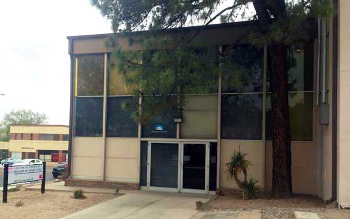](https://web.archive.org/web/20151001083235/http://www.hpcerc.unm.edu/common/images/carcfront.jpg){target=_blank}

*The CARC entrance at the Galles Building, from the center's website
(captured 2015).*

The current machine room was dedicated in **2005** as part of a renovation
of the Galles Building that also created space for the ARTS Lab. CARC's
history page gives its size as 1,500 sq ft; the current
[facilities description](facilities.md) gives 1,200 sq ft.[^carc-history]
A cooling, UPS and hot-aisle containment upgrade costing just over
**$250,000** (paid by CARC, the Provost and the Office of the Vice
President for Research) was finished around March 2015 so that all of
Ulam could run.[^lobo-2015]

[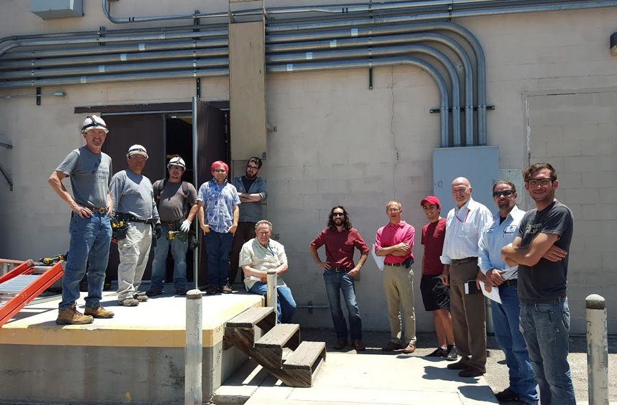](https://web.archive.org/web/20150909122553/http://www.ahpcc.unm.edu/common/images/slide_mmr.jpg){target=_blank}

*The 2015 machine-room upgrade, from the CARC website (captured Sep
2015).*

[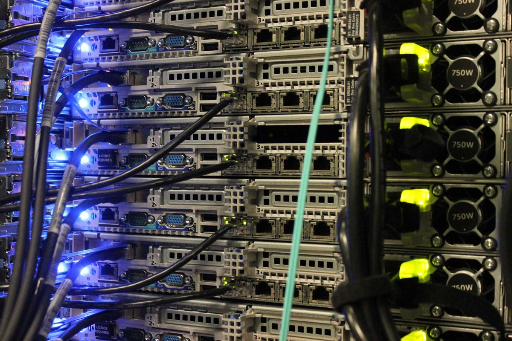](https://web.archive.org/web/20150926095013/http://www.ahpcc.unm.edu/common/images/blue.jpg){target=_blank}

*Machine-room cabling, from the CARC website (captured Sep 2015).*

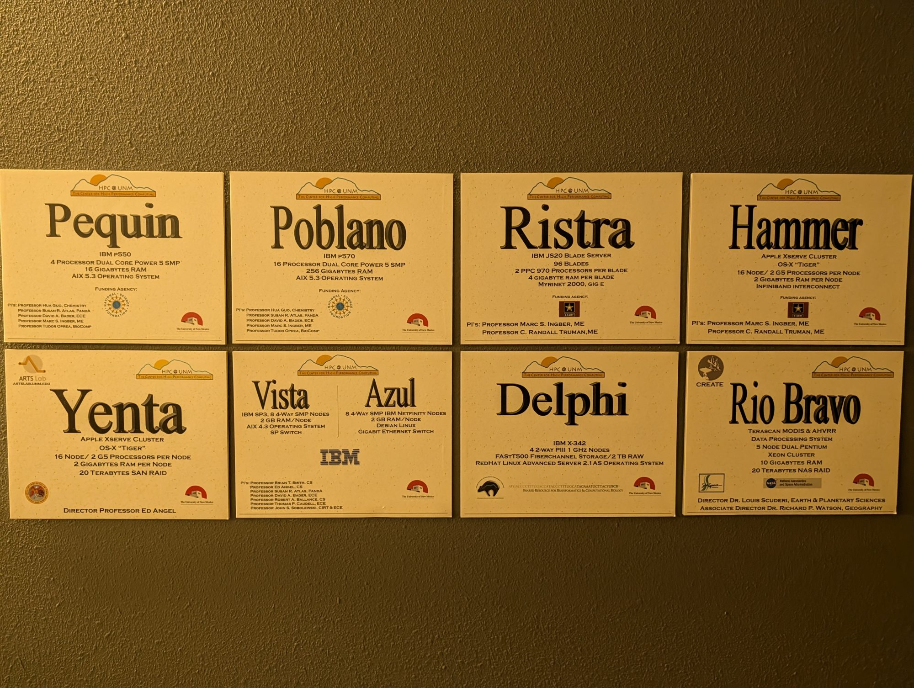

*The HPC@UNM machine plaques that still hang on the Galles Building
machine-room wall (photo, July 2026).*

## Timeline

Bars show the years each system was in service. Where an install or
retirement year is not documented, the bar uses the estimate given in the
machine tables below, and the label ends in "est.".

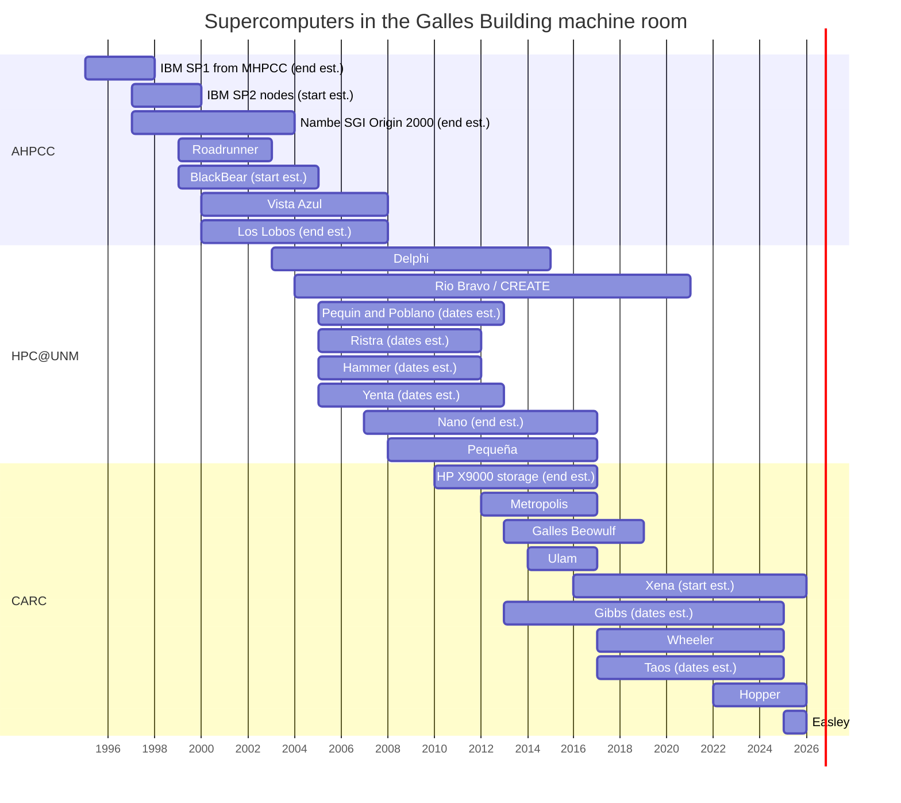

| Year | Event |
| ---- | ----- |
| 1993 | Frank Gilfeather, Brian T. Smith and John S. Sobolewski found the Maui High Performance Computing Center (MHPCC) for the DoD, with about $21M of initial Air Force/ARPA funding.[^carc-history][^top500-1995] |
| 1994 | The Albuquerque Resource Center (ARC), later AHPCC, opens in the Galles Building under the new HPCERC umbrella, with 10 students and one research scientist.[^carc-history][^ahpcc-2000] |
| Late 1995 | The original IBM SP1 from MHPCC is installed in Albuquerque, the first supercomputer in the Galles Building.[^ahpcc-2000] A 1998 HPCERC page describes it as a 32-node SP1.[^hpcerc-1998] |
| 1996 | The ARC is formally chartered. AHPCC hosts an NSF Chautauqua meeting.[^ahpcc-2000][^carc-history] |
| Mid-1997 | The ARC is renamed the Albuquerque High Performance Computing Center (AHPCC). It prepares to receive 128 IBM SP2 nodes from MHPCC and gets an 8-node SGI Origin SMP, the machine later listed as **Nambe**.[^ahpcc-2000][^ahpcc-systems-1998] An undated AHPCC page from this period names Marc Ingber as AHPCC Director and Ernie Herrera as Deputy Director.[^ahpcc-about-old] |
| Nov 1998 | AHPCC's systems guide lists the SP2 (96 of 128 nodes configured), Nambe, the 12-node **Turing** Pentium cluster and a set of SGI and RS/6000 workstations; the SP1 is no longer listed.[^ahpcc-systems-1998] |
| 1998 | A Jan 1998 release says AHPCC was "establishing a 128-node IBM SP system", which matches the SP2 nodes from MHPCC.[^newswise-1998][^ahpcc-2000] The 16-CPU Roadrunner prototype is running by April. The building expansion starts in November.[^arxiv-linux][^ahpcc-2000] |
| Jan 1999 | The NCSA Alliance funds a 128-processor Linux supercluster, which becomes Roadrunner.[^ahpcc-2000] |
| Mar–Jul 1999 | **Roadrunner** arrives (Mar 17 and 31), is dedicated Apr 8 with Sen. Pete Domenici and NCSA's Larry Smarr, and opens to national users Jul 1, the first Linux cluster available through NSF national allocation.[^arxiv-linux][^bader-ncsa-1999][^carc-history] |
| 1999 | The Access Grid teleconferencing system is installed; UNM hosts the first-ever Access Grid session and Alliance Chautauqua '99 (Aug 9–10).[^carc-history][^evl-1999] |
| Dec 1999 | IBM announces the **Vista Azul** Shared University Research (SUR) award. Azul's Netfinity nodes arrive Dec 16 and are running by Jan 5, 2000.[^bader-ibm-1999][^vista-azul-status] |
| Mar 2000 | The SP2 is retired: Feb 29 is the last day for production runs, and by March "the SP-2 has left the building". Users move to **BlackBear**.[^ahpcc-nl-2000] |
| 2000 | **Los Lobos** (512 processors, IBM) is announced Mar 21, delivered in April and formally opened Sep 13. IBM opens its Linux Supercluster Briefing Center at AHPCC on Sep 15.[^bader-lobos-2000][^bader-opening-2000][^bader-briefing-2000] |
| 2000 | **Vista Azul** is deployed (PI Brian T. Smith).[^carc-history] |
| Jul 2000 | The W.M. Keck Foundation gives the UNM Health Sciences Center a $1 million cancer-genomics grant (lead investigator Cheryl Willman) in which HPCERC develops the data storage and analysis, with Sandia as a partner.[^keck-2000][^ahpcc-news-2000] |
| Nov 2000 | Los Lobos enters the TOP500 at **#80**; it drops off after Nov 2002 (#297).[^top500] |
| Sep 2001 | UNM's operation of MHPCC ends, and AHPCC is folded into HPCERC.[^hpcerc-2003-about] |
| 2003 | Marc Ingber is named Executive Director in January (Interim Director in the April staff directory) and the center becomes HPC@UNM.[^hpcerc-2003-about][^hpcerc-2003-dir] The **Delphi** parallel Oracle server hosts the UNM Cancer Center's GenomeDW genomics data warehouse.[^carc-history][^bader-hpc-2003] Roadrunner is last listed in Aug 2003 and is gone from the machine list by November.[^hpcerc-2003][^hpc-machines-2003] |
| Sep 2003 | NASA awards $1.78M (secured by Sen. Jeff Bingaman) for CREATE's satellite receiving and processing system, the origin of **Rio Bravo**.[^lobo-2003] |
| 2004 | Barney Maccabe is named Director and Tim Thomas Deputy Director (from June 1). NSF awards MRI **DBI-0420513** ($350,378), the shared-memory computer the plaques identify as **Pequin** and **Poblano**.[^carc-history][^physics-2004][^nsf-0420513] |
| 2005 | The new Galles Building machine room is dedicated; the ARTS Lab opens in December.[^carc-history][^lobo-2005] |
| Nov 2005 | Every system is moved into the new machine room on Nov 9, 2005: the Army-funded **Ristra** and **Hammer** clusters (until then "located outside the Gallas building"), the ARTS Lab's **Yenta**, the MRI's **Pequin** and **Poblano**, Delphi, the CREATE cluster, Azul and BlackBear's rack. Los Lobos and Vista stay where they are. All are back up by Nov 11.[^hpc-move-2005] |
| Feb 2007 | Tom Caudell becomes Director.[^engr-2007] |
| Aug 2007 | A maintenance notice lists Poblano, Pequin, **Nano**, Rio Rancho, Los Lobos and the RCDE and Truchas boxes, the last record of Los Lobos in service.[^hpc-outage-2007] |
| 2008 | The HPC@UNM systems table lists **Pequin**, **Poblano**, **Ristra**, **Hammer**, **Nano** (Dell) and **Pequeña** (SGI Altix ICE) in service; Los Lobos is no longer listed. Vista's compute nodes go down on Jul 2, 2008 and are never brought back.[^hpc-systems-2008][^hpc-irs-2010] |
| Jun 2009 | Susan R. Atlas becomes Director; the center is renamed CARC.[^physics-2009] |
| 2010 | The UNM Research Storage Consortium (DataONE, the Long-Term Ecological Research network, EDAC, CARC and University Libraries) installs a **281 TB HP X9000** storage system; Andrea Polli's *e-Oculus* installation, built in the Galles Building, debuts at its commissioning. NSF awards MRI **ACI-1040530** ($435,077) for the GPU cluster later named **Xena**.[^carc-history][^nsf-1040530] |
| 2011 | CARC announces "the planned deployment of the Xena parallel Fermi Tesla GPU supercomputer in Spring '11".[^hpc-xena-2011] The CARC Gallery opens, and at SC11 CARC links performers in Albuquerque and Seattle over National LambdaRail for Kurt Schwitters' *Ursonate*.[^carc-history] |
| 2012 | **Metropolis**, a repurposed LANL machine, is donated by the New Mexico Consortium under NSF's PRObE project.[^carc-history] |
| 2013 | The 200-node "green" **Galles** Beowulf cluster, built from used campus Dell desktops, is commissioned with a Hadoop subsystem. CARC's SC13 *Big Data to Knowledge* video features nine UNM researchers.[^carc-history] By April the machine-state page shows **Gibbs** and Metropolis up and Ristra, Hammer and Pequin decommissioned.[^hpc-irs-2013] |
| 2014 | **Ulam** (120 nodes, 960 cores) arrives from the New Mexico Consortium (shipments Dec 2013 and Jan 16, 2014); CARC's aggregate reaches 2,200 cores and 15 TFLOPS peak. A dedicated 10 Gbps Science DMZ link to the Cancer Research Facility is established in August.[^unm-ulam-2014][^carc-history][^carc-dmz-2014] NSF awards CC*IIE **1440779** ($498,620) for a UNM research network linking to CARC, UNM's first NSF cyberinfrastructure grant.[^nsf-1440779][^carc-nsf-2014] |
| 2015 | CARC's systems page lists Nano, Pequeña, Gibbs, a new Poblano, Metropolis, Ulam and Galles, plus 381 TB of Research Storage Consortium disk.[^carc-systems-2015] |
| 2016 | Patrick Bridges is named Interim Director.[^carc-history][^carc-staff-2016] **Xena** enters service: it is still "coming online" in Sep 2015 and is listed as a production system by Sep 2016. The systems page now counts more than 3,000 cores and gives the storage as about 1.5 PB raw.[^carc-xena-2015][^carc-systems-2016] |
| Mar 2017 | LANL/NMC donate **Wheeler**. Phase 1 replaces Metropolis and Pequeña; Phase 2 (Fall 2017) replaces Ulam.[^hpcwire-2017][^carc-wheeler] |
| 2018 | Bridges is named Director.[^carc-history] |
| 2019 | The Galles Beowulf cluster is retired after the late-May 2019 downtime; NetApp "Chama" replaces the Serrano fileserver.[^carc-history][^carc-upgrades-2019] |
| 2020 | CARC and several PIs begin buying condo hardware to expand **Taos**.[^iab-2020] |
| 2021 | CREATE ends after 17 years at CARC. Ylva Pihlström becomes Associate Director. A Hopper condo base system is ordered from Dell.[^carc-history][^carc-assoc-2021][^iab-2021] |
| 2022 | **Hopper** launches as a condo cluster (53 nodes at launch).[^carc-hopper] |
| 2025 | **Easley** (Dell, NVIDIA, IBM storage) replaces Wheeler.[^carc-easley] |
| 2026 | Wheeler, Taos, Gibbs and Xena are recorded as retired (exact decommission dates unknown).[^legacy-specs] NSF awards MRI **2511915** ($1,399,999) for a new GPU cluster for quantum- and AI-driven chemistry (start Mar 15, 2026).[^nsf-2511915] Tyson L. Swetnam becomes Director on Jul 1, 2026.[^carc-swetnam] |

## Leadership

### Directors

| Years | Name | Notes |
| ----- | ---- | ----- |
| 1994–c. 2003 | **Frank L. Gilfeather** (Mathematics) | Executive Director of HPCERC, which managed AHPCC and MHPCC.[^bader-1999][^newswise-1998] |
| c. 1997–1999 | **Marc S. Ingber** (Mechanical Engineering) | AHPCC Director, with Ernie Herrera as Deputy Director, on an undated AHPCC "About" page that describes the 1997–98 lab (32-node SP, Origin 2000); captured May 2000.[^ahpcc-about-old] Dates inferred. |
| c. 2000–2002 | **Brian T. Smith** (Computer Science) | AHPCC Director on the 2000 organization chart and the Vista Azul contact page.[^ahpcc-org-2000][^vista-azul-people] Also Chief Scientist of HPCERC by Jul 2000, and Chief Scientist of HPC@UNM and CARC through at least 2013 ("Chief Scientist (emeritus)" in 2015).[^keck-2000][^hpcerc-2003-dir][^hpc-org-2007][^hpc-staff-2013][^carc-staff-2015] Start and end dates as AHPCC Director: unknown. |
| 2003–2004 | **Marc S. Ingber** (Mechanical Engineering) | Took over HPCERC on Jan 1, 2003, listed as Interim Director in April 2003 and Executive Director in Feb 2004; first director of HPC@UNM.[^hpcerc-2003-about][^hpcerc-2003-dir][^hpc-dir-2004][^carc-history][^bader-hpc-2003] |
| 2004–Jan 2007 | **Arthur B. (Barney) Maccabe** (Computer Science) | Left to become UNM's interim CIO.[^carc-history][^engr-2007] |
| Feb 2007–May 2009 | **Thomas P. Caudell** (Electrical and Computer Engineering) | Moved on to ARTS Lab initiatives.[^engr-2007][^physics-2009] |
| Jun 2009–2016 | **Susan R. Atlas** (Physics and Astronomy) | Center renamed CARC on her appointment. Still listed as Director in Sep 2015.[^physics-2009][^carc-staff-2015] |
| 2016–2018 | **Patrick G. Bridges** (Computer Science) | Interim Director (on the staff page by Sep 2016).[^carc-history][^carc-staff-2016] |
| 2018–2026 | **Patrick G. Bridges** | Director.[^carc-history] |
| 2026–present | **Tyson L. Swetnam** | Director from Jul 1, 2026.[^carc-swetnam] |

Founders of the predecessor centers: **Frank Gilfeather, Brian T. Smith and
John S. Sobolewski** (MHPCC, 1993).[^carc-history]

### Associate and deputy directors

| Years | Name | Role |
| ----- | ---- | ---- |
| c. 1997–1999 | Ernest D. Herrera | Deputy Director, AHPCC[^ahpcc-about-old] |
| c. 2000–2003 | Ernest D. Herrera | Associate Director, Administration and Operations (AHPCC, then HPCERC and HPC@UNM)[^ahpcc-org-2000][^hpcerc-2003-dir][^hpc-dir-2003] |
| c. 2000–2003 | Susan R. Atlas (Physics and Astronomy) | Associate Director, Science and Engineering Research (AHPCC, then HPCERC and HPC@UNM)[^ahpcc-org-2000][^hpcerc-2003-dir][^hpc-dir-2003] |
| c. 2000–2003 | Robert A. Ballance (Computer Science) | Associate Director, Computer Systems Research (AHPCC, then HPCERC and HPC@UNM)[^ahpcc-org-2000][^hpcerc-2003-dir][^hpc-dir-2003] |
| 2003 | Kenneth Summers (Computer Science) | Associate Director, Visualization Laboratory[^hpc-dir-2003] |
| 2003 | John S. Sobolewski | Chief Technologist, HPCERC[^hpcerc-2003-dir] |
| 2003–2004 | Arthur B. (Barney) Maccabe | Associate Director, HPC@UNM[^bader-hpc-2003][^hpc-dir-2004] |
| Jun 2004–c. 2012 | Timothy L. Thomas (Physics and Astronomy) | Deputy Director (also signing as "CARC Operations Director" in 2010). Last named as Deputy Director in Jan 2012; not listed in 2013.[^physics-2004][^hpc-outage-2010][^hpc-home-2012][^hpc-staff-2013] |
| c. 2011 | Andrea Polli (Interdisciplinary Film and Digital Media) | "CARC Associate and Social Media Workgroup Director"[^carc-history] |
| 2021–unknown | Ylva Pihlström (Physics and Astronomy) | Associate Director[^carc-assoc-2021] |
| unknown–present | Matthew Fricke (Computer Science) | Associate Director[^carc-personnel] |

Program directors named on the plaques: **Edward Angel** (Director, ARTS
Lab, for Yenta), **Louis Scuderi** (Director, CREATE, for Rio Bravo) and
**Richard P. Watson** (Associate Director, CREATE).[^plaques]

[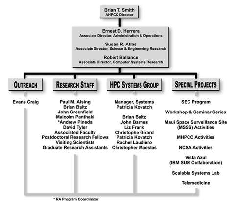](https://web.archive.org/web/20000817235734/http://www.ahpcc.unm.edu:80/Images/Graphics/AHPCC_Org_Chart.gif){target=_blank}

*AHPCC organization chart, 2000: Director Brian T. Smith with Associate
Directors Ernest Herrera, Susan Atlas and Robert Ballance, and Patricia
Kovatch as systems manager.[^ahpcc-org-2000]*

[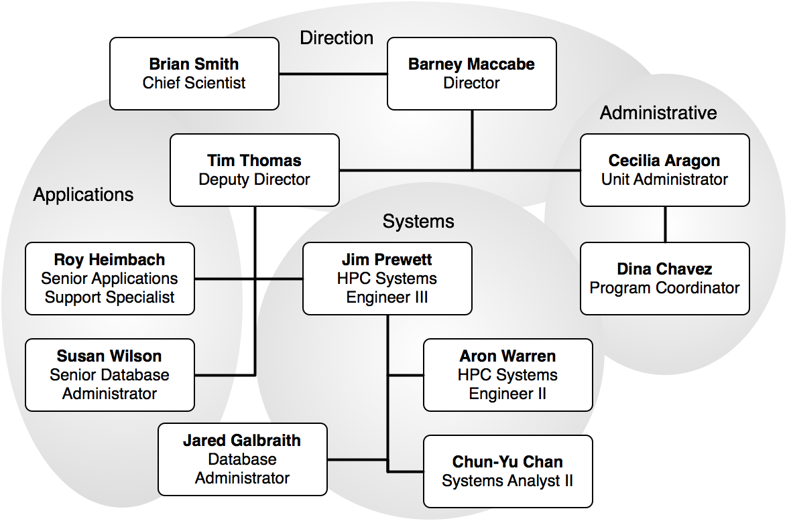](https://web.archive.org/web/20070313102152/http://www.hpc.unm.edu:80/info/staff-information/OrgChart.png){target=_blank}

*HPC@UNM organization chart, 2007: Director Barney Maccabe, Chief
Scientist Brian Smith and Deputy Director Tim Thomas. It was captured in
March 2007 but had not yet been updated for Tom Caudell's February 2007
appointment.[^hpc-org-2007][^engr-2007]*

### Staff named in the record

Patricia Kovatch (Roadrunner project engineer, 1999; manager of the HPC
Systems Group, 2000),[^bader-hpcwire-1999] John Barnes (Vista Azul
systems lead engineer, c. 2000),[^vista-azul-people] Cecilia Aragon
(Administration and Operations Manager, 2004; Unit Administrator,
2006–07),[^hpc-dir-2004][^hpc-dir-2006] Roy Heimbach (senior applications
support analyst, 2003–13), Chun-Yu Chan (network and Access Grid, 2004–13),
Jared Galbraith (database administrator and developer of the AIRS
reporting system, 2004–07),[^hpc-dir-2004][^hpc-dir-2006][^hpc-staff-2013] James E. Prewett (HPC systems
lead; retired c. 2026),[^carc-departures] Susan Wilson (senior database administrator, 2004–15) and Ben Archuleta
(CARC systems, 2014),[^ladp-2014][^carc-staff-2015] Ryan Johnson (user
support, 2015–16),[^carc-staff-2016] Hussein Al-Azzawi (network and storage
specialist, then HPC IT Manager, who led the Easley acquisition; left
June 2026).[^charlotte-2026]

## PIs who contributed hardware

| PI | Department | Systems | Funding |
| -- | ---------- | ------- | ------- |
| Brian T. Smith | Computer Science | Vista Azul (one of six PIs; CARC's history calls him the PI) | IBM SUR award[^carc-history][^vista-azul-proposal] |
| Edward Angel | Computer Science / ARTS Lab | Vista Azul; Yenta (director) | IBM SUR; ARTS Lab (state Media Industries Strategic Project)[^plaques][^cs-2005] |
| Susan R. Atlas | Physics and Astronomy / PANDA | Vista Azul; Pequin and Poblano; Xena (lead PI); 2026 MRI (lead PI) | IBM SUR; NSF DBI-0420513, ACI-1040530, 2511915[^plaques][^nsf-0420513][^nsf-1040530][^nsf-2511915] |
| David A. Bader | Electrical and Computer Engineering | Vista Azul; Pequin and Poblano; Roadrunner performance evaluation | IBM SUR; NSF DBI-0420513[^plaques][^vista-azul-proposal][^nsf-0420513] |
| Robert A. Ballance | Computer Science | Vista Azul | IBM SUR[^plaques] |
| Thomas P. Caudell | Electrical and Computer Engineering | Vista Azul | IBM SUR[^plaques] |
| John S. Sobolewski | CIRT and ECE | Vista Azul | IBM SUR[^plaques] |
| Hua Guo | Chemistry | Pequin and Poblano (lead PI); Xena; 2026 MRI | NSF DBI-0420513, ACI-1040530, 2511915[^nsf-0420513][^nsf-1040530][^nsf-2511915] |
| Marc S. Ingber | Mechanical Engineering | Pequin and Poblano; Ristra; Hammer | NSF DBI-0420513; US Army[^plaques][^nsf-0420513] |
| Tudor I. Oprea | Biocomputing | Pequin and Poblano | NSF DBI-0420513[^nsf-0420513] |
| C. Randall Truman | Mechanical Engineering | Ristra; Hammer | US Army[^plaques] |
| Louis Scuderi | Earth and Planetary Sciences | Rio Bravo / CREATE | NASA[^plaques][^lobo-2003] |
| Richard P. Watson | Geography | Rio Bravo / CREATE | NASA[^plaques] |
| Timothy L. Thomas | Physics and Astronomy | Xena; Metropolis, Ulam and Wheeler (co-PI on NMC's PRObE award) | NSF ACI-1040530; CNS-1042537 (former co-PI)[^nsf-1040530][^nsf-1042537] |
| Lydia Tapia | Computer Science | Xena | NSF ACI-1040530[^nsf-1040530] |
| Pradeep Sen; Jamesina Simpson | ECE | Xena (former co-PIs) | NSF ACI-1040530[^nsf-1040530] |
| Melanie Moses | Computer Science | Hopper condo nodes | PI-purchased priority nodes[^carc-hopper] |
| Ivan Deutsch; Patrick G. Bridges; Yi He | Physics; Computer Science; Chemistry | 2026 MRI GPU cluster (co-PIs) | NSF 2511915[^nsf-2511915] |
| Eric O. Lindsey; Mousumi Roy; Lindsay L. Worthington; Brandon Schmandt | Earth and Planetary Sciences | Geophysics compute nodes "hosted at the UNM Center for Advanced Research Computing" (2022) | NSF 2146272 ($94,997)[^nsf-2146272] |

The other condo PIs on Taos (2020) and Hopper (2021–22) are not named in
any public record found, and neither are the units behind the Delphi
"Shared Resource for Bioinformatics and Computational Biology".[^iab-2020][^iab-2021]

## The machines

Peak performance is theoretical double-precision peak (Rpeak) unless noted.
"(est.)" peaks are computed as cores × clock × floating-point operations
per cycle, using the usual clock speeds for that processor; the clocks are
not on record. "2003+" means the machine was still listed in the April 2003
HPCERC systems inventory.

### Summary

| Machine | In service | Maker / model | Cores | Peak | Funding | Cost |
| ------- | ---------- | ------------- | ----: | ---- | ------- | ---- |
| Roadrunner | 1999–2003 | Alta Technology AltaCluster | 128 | 63 GFLOPS | NSF / NCSA Alliance, matched by UNM | about $400,000 (< $6,500 per node); $400K NSF for Phase 2 |
| BlackBear | by Feb 2000–2004+ | VA Linux 501 | 32 | ~18 GFLOPS (est.) | unknown | unknown |
| Vista Azul | Jan 2000–2008 | IBM RS/6000 SP + Netfinity 5500 | 32 + 32 | ~40 GFLOPS (est.) | IBM SUR award | unknown |
| Los Lobos | 2000–2007+ | IBM Netfinity 4500R cluster | 512 | 375.3 GFLOPS (Rmax 237) | NSF via NCSA Alliance | unknown |
| Delphi | 2003–2015 | IBM xSeries 342 | 8 | ~8 GFLOPS (est.) | UNM Cancer Center (SRBCB) | unknown |
| Rio Bravo | 2004–c. 2021 | TeraScan (SeaSpace) on a 5-node Xeon cluster | 10 CPUs | ~50 GFLOPS (est.) | NASA (congressional appropriation) | part of $1.78M award |
| Pequin | by Nov 2005–2010+ (gone by 2013) | IBM eServer p5 550 | 4 | 12 GFLOPS | NSF MRI DBI-0420513 | $350,378 award (both machines) |
| Poblano | by Nov 2005–2013+ | IBM eServer p5 570 | 16 | 61 GFLOPS | NSF MRI DBI-0420513 | (see Pequin) |
| Ristra | by Nov 2005–2010+ (gone by 2013) | IBM BladeCenter JS20 | 192 | 1.2 TFLOPS | US Army | unknown |
| Hammer | 2005–2010+ (gone by 2013) | Apple Xserve G5 | 32 | 256 GFLOPS | US Army (same grant as Ristra) | unknown |
| Yenta | by Nov 2005–2013+ | Apple Xserve G5 | 32 | ~0.26–0.29 TFLOPS (est.) | ARTS Lab (State of New Mexico) | unknown |
| Nano | by Aug 2007–2016+ | Dell PowerEdge 1950 | 140 (2015) | 1.288 TFLOPS | unknown | unknown |
| Pequeña | by 2008–2017 | SGI Altix ICE | 176 | 2.1 TFLOPS | unknown | unknown |
| HP X9000 | 2010–unknown | HP StorageWorks X9000 | storage | 281 TB usable | UNM Research Storage Consortium | unknown |
| Metropolis | 2012–2017 | Linux Networx Evolocity (ex-LANL) | 140 | 0.728 TFLOPS | donated (NSF PRObE / NMC) | donated |
| Galles | 2013–2019 | 200 used Dell OptiPlex desktops | 400 | 2.2 TFLOPS | reused campus hardware | ~$0 hardware |
| Ulam | 2014–2017 | IBM System x3755 (ex-LANL) | 960 | 4.2 TFLOPS | donated (NSF PRObE / NMC) | donated; $250K+ room upgrade |
| Gibbs | by Apr 2013–c. 2025 | Dell PowerEdge R620 | 384 | 3.996 TFLOPS | unknown | unknown |
| Xena | c. 2016–2026 | Dell PowerEdge R730 / R930 + K40M GPUs | 576 | 18 TFLOPS CPU + ~46 TFLOPS GPU (est.) | NSF MRI ACI-1040530 | $435,077 award |
| Wheeler | 2017–c. 2025 | SGI Altix XE (ex-LANL) | 2,432 | 25 TFLOPS | donated (NSF PRObE / NMC) | donated |
| Taos | unknown–c. 2025 | Dell PowerEdge R630 (condo) | 180 | ~6 TFLOPS (est.) | CARC + PI condo | unknown |
| Hopper | 2022–present | Dell PowerEdge R640 / R740 + A100 | 2,176 | ~0.56 PFLOPS incl. GPUs (est.) | OVPR + PI condo (50/50 for the base) | unknown |
| Easley | 2025–present | Dell, NVIDIA NDR, IBM Storage Scale | 4,160 | ~0.59 PFLOPS incl. GPUs (est.) | UNM institutional (no external grant found) | unknown |

### Capacity over time

The chart adds up every machine in service at any time during each year. It
counts CPU cores only (GPUs add to peak performance but not to cores),
and storage means disk attached to the machines plus the center's shared
file systems where a source gives a size.

<!-- capacity-timeline:start -->

<svg class="cc-svg" viewBox="0 0 760 460" role="img" aria-labelledby="cc-t cc-d" xmlns="http://www.w3.org/2000/svg"><title id="cc-t">CARC computing capacity by year, 1995–2026</title><desc id="cc-d">Four log-scale step charts of the total peak performance (CPU, and CPU plus GPU), CPU cores, memory and storage of all machines in service each year. The table below the chart gives the same totals.</desc><text class="cc-title" x="4" y="14">Peak performance</text><line class="cc-line" x1="150" x2="166" y1="10" y2="10"/><text class="cc-axis" x="170" y="14">CPU</text><line class="cc-line2" x1="200.6" x2="216.6" y1="10" y2="10"/><text class="cc-axis" x="220.6" y="14">CPU + GPU</text><line class="cc-grid" x1="76" x2="296.0" y1="202.0" y2="202.0"/><text class="cc-axis" x="70" y="206.0" text-anchor="end">1&#160;GFLOPS</text><line class="cc-grid" x1="76" x2="296.0" y1="176.9" y2="176.9"/><text class="cc-axis" x="70" y="180.9" text-anchor="end">10&#160;GFLOPS</text><line class="cc-grid" x1="76" x2="296.0" y1="151.7" y2="151.7"/><text class="cc-axis" x="70" y="155.7" text-anchor="end">100&#160;GFLOPS</text><line class="cc-grid" x1="76" x2="296.0" y1="126.6" y2="126.6"/><text class="cc-axis" x="70" y="130.6" text-anchor="end">1&#160;TFLOPS</text><line class="cc-grid" x1="76" x2="296.0" y1="101.4" y2="101.4"/><text class="cc-axis" x="70" y="105.4" text-anchor="end">10&#160;TFLOPS</text><line class="cc-grid" x1="76" x2="296.0" y1="76.3" y2="76.3"/><text class="cc-axis" x="70" y="80.3" text-anchor="end">100&#160;TFLOPS</text><line class="cc-grid" x1="76" x2="296.0" y1="51.1" y2="51.1"/><text class="cc-axis" x="70" y="55.1" text-anchor="end">1&#160;PFLOPS</text><line class="cc-grid" x1="76" x2="296.0" y1="26.0" y2="26.0"/><text class="cc-axis" x="70" y="30.0" text-anchor="end">10&#160;PFLOPS</text><text class="cc-axis" x="113.8" y="218.0" text-anchor="middle">2000</text><text class="cc-axis" x="182.6" y="218.0" text-anchor="middle">2010</text><text class="cc-axis" x="251.3" y="218.0" text-anchor="middle">2020</text><path class="cc-line2" d="M220.4,78.9 L227.2,78.9 L227.2,76.1 L234.1,76.1 L234.1,76.2 L241.0,76.2 L241.0,76.2 L247.9,76.2 L247.9,76.4 L254.8,76.4 L254.8,76.4 L261.6,76.4 L261.6,55.7 L268.5,55.7 L268.5,55.7 L275.4,55.7 L275.4,55.7 L282.2,55.7 L282.2,48.7 L289.1,48.7 L289.1,49.0 L296.0,49.0"/><circle class="cc-dot cc-line2-dot" cx="296.0" cy="49.0" r="4"/><path class="cc-line" d="M76.0,186.9 L82.9,186.9 L82.9,186.9 L89.8,186.9 L89.8,161.5 L96.6,161.5 L96.6,162.6 L103.5,162.6 L103.5,151.7 L110.4,151.7 L110.4,133.5 L117.2,133.5 L117.2,133.4 L124.1,133.4 L124.1,133.4 L131.0,133.4 L131.0,133.2 L137.9,133.2 L137.9,133.6 L144.8,133.6 L144.8,117.4 L151.6,117.4 L151.6,117.4 L158.5,117.4 L158.5,112.7 L165.4,112.7 L165.4,108.4 L172.2,108.4 L172.2,108.5 L179.1,108.5 L179.1,108.5 L186.0,108.5 L186.0,108.5 L192.9,108.5 L192.9,107.1 L199.8,107.1 L199.8,100.7 L206.6,100.7 L206.6,97.3 L213.5,97.3 L213.5,97.3 L220.4,97.3 L220.4,88.5 L227.2,88.5 L227.2,82.6 L234.1,82.6 L234.1,82.8 L241.0,82.8 L241.0,82.8 L247.9,82.8 L247.9,83.2 L254.8,83.2 L254.8,83.2 L261.6,83.2 L261.6,66.2 L268.5,66.2 L268.5,66.2 L275.4,66.2 L275.4,66.2 L282.2,66.2 L282.2,58.2 L289.1,58.2 L289.1,59.0 L296.0,59.0"/><circle class="cc-dot cc-line-dot" cx="296.0" cy="59.0" r="4"/><text class="cc-label" x="303.0" y="53.0">1.21 PFLOPS</text><text class="cc-label" x="303.0" y="67.0">488 TFLOPS</text><rect class="cc-hit" x="76.0" y="26" width="6.9" height="176.0"><title>1995: CPU 4 GFLOPS</title></rect><rect class="cc-hit" x="82.9" y="26" width="6.9" height="176.0"><title>1996: CPU 4 GFLOPS</title></rect><rect class="cc-hit" x="89.8" y="26" width="6.9" height="176.0"><title>1997: CPU 41 GFLOPS</title></rect><rect class="cc-hit" x="96.6" y="26" width="6.9" height="176.0"><title>1998: CPU 37 GFLOPS</title></rect><rect class="cc-hit" x="103.5" y="26" width="6.9" height="176.0"><title>1999: CPU 100 GFLOPS</title></rect><rect class="cc-hit" x="110.4" y="26" width="6.9" height="176.0"><title>2000: CPU 532 GFLOPS</title></rect><rect class="cc-hit" x="117.2" y="26" width="6.9" height="176.0"><title>2001: CPU 535 GFLOPS</title></rect><rect class="cc-hit" x="124.1" y="26" width="6.9" height="176.0"><title>2002: CPU 535 GFLOPS</title></rect><rect class="cc-hit" x="131.0" y="26" width="6.9" height="176.0"><title>2003: CPU 543 GFLOPS</title></rect><rect class="cc-hit" x="137.9" y="26" width="6.9" height="176.0"><title>2004: CPU 527 GFLOPS</title></rect><rect class="cc-hit" x="144.8" y="26" width="6.9" height="176.0"><title>2005: CPU 2.31 TFLOPS</title></rect><rect class="cc-hit" x="151.6" y="26" width="6.9" height="176.0"><title>2006: CPU 2.31 TFLOPS</title></rect><rect class="cc-hit" x="158.5" y="26" width="6.9" height="176.0"><title>2007: CPU 3.58 TFLOPS</title></rect><rect class="cc-hit" x="165.4" y="26" width="6.9" height="176.0"><title>2008: CPU 5.27 TFLOPS</title></rect><rect class="cc-hit" x="172.2" y="26" width="6.9" height="176.0"><title>2009: CPU 5.25 TFLOPS</title></rect><rect class="cc-hit" x="179.1" y="26" width="6.9" height="176.0"><title>2010: CPU 5.25 TFLOPS</title></rect><rect class="cc-hit" x="186.0" y="26" width="6.9" height="176.0"><title>2011: CPU 5.25 TFLOPS</title></rect><rect class="cc-hit" x="192.9" y="26" width="6.9" height="176.0"><title>2012: CPU 5.97 TFLOPS</title></rect><rect class="cc-hit" x="199.8" y="26" width="6.9" height="176.0"><title>2013: CPU 10.7 TFLOPS</title></rect><rect class="cc-hit" x="206.6" y="26" width="6.9" height="176.0"><title>2014: CPU 14.6 TFLOPS</title></rect><rect class="cc-hit" x="213.5" y="26" width="6.9" height="176.0"><title>2015: CPU 14.6 TFLOPS</title></rect><rect class="cc-hit" x="220.4" y="26" width="6.9" height="176.0"><title>2016: CPU 32.6 TFLOPS; CPU + GPU 78.4 TFLOPS</title></rect><rect class="cc-hit" x="227.2" y="26" width="6.9" height="176.0"><title>2017: CPU 56.3 TFLOPS; CPU + GPU 102 TFLOPS</title></rect><rect class="cc-hit" x="234.1" y="26" width="6.9" height="176.0"><title>2018: CPU 55.2 TFLOPS; CPU + GPU 101 TFLOPS</title></rect><rect class="cc-hit" x="241.0" y="26" width="6.9" height="176.0"><title>2019: CPU 55.2 TFLOPS; CPU + GPU 101 TFLOPS</title></rect><rect class="cc-hit" x="247.9" y="26" width="6.9" height="176.0"><title>2020: CPU 53 TFLOPS; CPU + GPU 98.8 TFLOPS</title></rect><rect class="cc-hit" x="254.8" y="26" width="6.9" height="176.0"><title>2021: CPU 53 TFLOPS; CPU + GPU 98.8 TFLOPS</title></rect><rect class="cc-hit" x="261.6" y="26" width="6.9" height="176.0"><title>2022: CPU 253 TFLOPS; CPU + GPU 658 TFLOPS</title></rect><rect class="cc-hit" x="268.5" y="26" width="6.9" height="176.0"><title>2023: CPU 253 TFLOPS; CPU + GPU 658 TFLOPS</title></rect><rect class="cc-hit" x="275.4" y="26" width="6.9" height="176.0"><title>2024: CPU 253 TFLOPS; CPU + GPU 658 TFLOPS</title></rect><rect class="cc-hit" x="282.2" y="26" width="6.9" height="176.0"><title>2025: CPU 523 TFLOPS; CPU + GPU 1.25 PFLOPS</title></rect><rect class="cc-hit" x="289.1" y="26" width="6.9" height="176.0"><title>2026: CPU 488 TFLOPS; CPU + GPU 1.21 PFLOPS</title></rect><text class="cc-title" x="390.0" y="14">CPU cores</text><line class="cc-grid" x1="462.0" x2="682.0" y1="202.0" y2="202.0"/><text class="cc-axis" x="456.0" y="206.0" text-anchor="end">10</text><line class="cc-grid" x1="462.0" x2="682.0" y1="143.3" y2="143.3"/><text class="cc-axis" x="456.0" y="147.3" text-anchor="end">100</text><line class="cc-grid" x1="462.0" x2="682.0" y1="84.7" y2="84.7"/><text class="cc-axis" x="456.0" y="88.7" text-anchor="end">1,000</text><line class="cc-grid" x1="462.0" x2="682.0" y1="26.0" y2="26.0"/><text class="cc-axis" x="456.0" y="30.0" text-anchor="end">10,000</text><text class="cc-axis" x="499.8" y="218.0" text-anchor="middle">2000</text><text class="cc-axis" x="568.6" y="218.0" text-anchor="middle">2010</text><text class="cc-axis" x="637.3" y="218.0" text-anchor="middle">2020</text><path class="cc-line" d="M462.0,172.4 L468.9,172.4 L468.9,172.4 L475.8,172.4 L475.8,130.1 L482.6,130.1 L482.6,135.5 L489.5,135.5 L489.5,118.6 L496.4,118.6 L496.4,88.2 L503.2,88.2 L503.2,89.4 L510.1,89.4 L510.1,89.4 L517.0,89.4 L517.0,89.1 L523.9,89.1 L523.9,93.2 L530.8,93.2 L530.8,85.8 L537.6,85.8 L537.6,85.8 L544.5,85.8 L544.5,83.0 L551.4,83.0 L551.4,96.0 L558.2,96.0 L558.2,97.3 L565.1,97.3 L565.1,97.3 L572.0,97.3 L572.0,97.3 L578.9,97.3 L578.9,92.0 L585.8,92.0 L585.8,77.9 L592.6,77.9 L592.6,64.4 L599.5,64.4 L599.5,64.4 L606.4,64.4 L606.4,58.6 L613.2,58.6 L613.2,43.3 L620.1,43.3 L620.1,49.5 L627.0,49.5 L627.0,49.5 L633.9,49.5 L633.9,52.2 L640.8,52.2 L640.8,52.2 L647.6,52.2 L647.6,40.1 L654.5,40.1 L654.5,40.1 L661.4,40.1 L661.4,40.1 L668.2,40.1 L668.2,26.2 L675.1,26.2 L675.1,35.4 L682.0,35.4"/><circle class="cc-dot cc-line-dot" cx="682.0" cy="35.4" r="4"/><text class="cc-label" x="689.0" y="39.4">6,912</text><rect class="cc-hit" x="462.0" y="26" width="6.9" height="176.0"><title>1995: 32</title></rect><rect class="cc-hit" x="468.9" y="26" width="6.9" height="176.0"><title>1996: 32</title></rect><rect class="cc-hit" x="475.8" y="26" width="6.9" height="176.0"><title>1997: 168</title></rect><rect class="cc-hit" x="482.6" y="26" width="6.9" height="176.0"><title>1998: 136</title></rect><rect class="cc-hit" x="489.5" y="26" width="6.9" height="176.0"><title>1999: 264</title></rect><rect class="cc-hit" x="496.4" y="26" width="6.9" height="176.0"><title>2000: 872</title></rect><rect class="cc-hit" x="503.2" y="26" width="6.9" height="176.0"><title>2001: 832</title></rect><rect class="cc-hit" x="510.1" y="26" width="6.9" height="176.0"><title>2002: 832</title></rect><rect class="cc-hit" x="517.0" y="26" width="6.9" height="176.0"><title>2003: 840</title></rect><rect class="cc-hit" x="523.9" y="26" width="6.9" height="176.0"><title>2004: 714</title></rect><rect class="cc-hit" x="530.8" y="26" width="6.9" height="176.0"><title>2005: 958</title></rect><rect class="cc-hit" x="537.6" y="26" width="6.9" height="176.0"><title>2006: 958</title></rect><rect class="cc-hit" x="544.5" y="26" width="6.9" height="176.0"><title>2007: 1,066</title></rect><rect class="cc-hit" x="551.4" y="26" width="6.9" height="176.0"><title>2008: 642</title></rect><rect class="cc-hit" x="558.2" y="26" width="6.9" height="176.0"><title>2009: 610</title></rect><rect class="cc-hit" x="565.1" y="26" width="6.9" height="176.0"><title>2010: 610</title></rect><rect class="cc-hit" x="572.0" y="26" width="6.9" height="176.0"><title>2011: 610</title></rect><rect class="cc-hit" x="578.9" y="26" width="6.9" height="176.0"><title>2012: 750</title></rect><rect class="cc-hit" x="585.8" y="26" width="6.9" height="176.0"><title>2013: 1,306</title></rect><rect class="cc-hit" x="592.6" y="26" width="6.9" height="176.0"><title>2014: 2,218</title></rect><rect class="cc-hit" x="599.5" y="26" width="6.9" height="176.0"><title>2015: 2,218</title></rect><rect class="cc-hit" x="606.4" y="26" width="6.9" height="176.0"><title>2016: 2,786</title></rect><rect class="cc-hit" x="613.2" y="26" width="6.9" height="176.0"><title>2017: 5,078</title></rect><rect class="cc-hit" x="620.1" y="26" width="6.9" height="176.0"><title>2018: 3,982</title></rect><rect class="cc-hit" x="627.0" y="26" width="6.9" height="176.0"><title>2019: 3,982</title></rect><rect class="cc-hit" x="633.9" y="26" width="6.9" height="176.0"><title>2020: 3,582</title></rect><rect class="cc-hit" x="640.8" y="26" width="6.9" height="176.0"><title>2021: 3,582</title></rect><rect class="cc-hit" x="647.6" y="26" width="6.9" height="176.0"><title>2022: 5,748</title></rect><rect class="cc-hit" x="654.5" y="26" width="6.9" height="176.0"><title>2023: 5,748</title></rect><rect class="cc-hit" x="661.4" y="26" width="6.9" height="176.0"><title>2024: 5,748</title></rect><rect class="cc-hit" x="668.2" y="26" width="6.9" height="176.0"><title>2025: 9,908</title></rect><rect class="cc-hit" x="675.1" y="26" width="6.9" height="176.0"><title>2026: 6,912</title></rect><text class="cc-title" x="4" y="250.0">Memory (RAM)</text><line class="cc-grid" x1="76" x2="296.0" y1="438.0" y2="438.0"/><text class="cc-axis" x="70" y="442.0" text-anchor="end">1&#160;GB</text><line class="cc-grid" x1="76" x2="296.0" y1="402.8" y2="402.8"/><text class="cc-axis" x="70" y="406.8" text-anchor="end">10&#160;GB</text><line class="cc-grid" x1="76" x2="296.0" y1="367.6" y2="367.6"/><text class="cc-axis" x="70" y="371.6" text-anchor="end">100&#160;GB</text><line class="cc-grid" x1="76" x2="296.0" y1="332.4" y2="332.4"/><text class="cc-axis" x="70" y="336.4" text-anchor="end">1&#160;TB</text><line class="cc-grid" x1="76" x2="296.0" y1="297.2" y2="297.2"/><text class="cc-axis" x="70" y="301.2" text-anchor="end">10&#160;TB</text><line class="cc-grid" x1="76" x2="296.0" y1="262.0" y2="262.0"/><text class="cc-axis" x="70" y="266.0" text-anchor="end">100&#160;TB</text><text class="cc-axis" x="113.8" y="454.0" text-anchor="middle">2000</text><text class="cc-axis" x="182.6" y="454.0" text-anchor="middle">2010</text><text class="cc-axis" x="251.3" y="454.0" text-anchor="middle">2020</text><path class="cc-line" d="M76.0,416.8 L82.9,416.8 L82.9,416.8 L89.8,416.8 L89.8,391.5 L96.6,391.5 L96.6,394.7 L103.5,394.7 L103.5,378.5 L110.4,378.5 L110.4,348.7 L117.2,348.7 L117.2,348.5 L124.1,348.5 L124.1,348.5 L131.0,348.5 L131.0,348.1 L137.9,348.1 L137.9,349.2 L144.8,349.2 L144.8,331.7 L151.6,331.7 L151.6,331.7 L158.5,331.7 L158.5,328.3 L165.4,328.3 L165.4,327.4 L172.2,327.4 L172.2,327.6 L179.1,327.6 L179.1,327.6 L186.0,327.6 L186.0,327.6 L192.9,327.6 L192.9,324.8 L199.8,324.8 L199.8,313.0 L206.6,313.0 L206.6,307.2 L213.5,307.2 L213.5,307.2 L220.4,307.2 L220.4,291.0 L227.2,291.0 L227.2,280.8 L234.1,280.8 L234.1,280.9 L241.0,280.9 L241.0,280.9 L247.9,280.9 L247.9,281.3 L254.8,281.3 L254.8,281.3 L261.6,281.3 L261.6,276.7 L268.5,276.7 L268.5,276.7 L275.4,276.7 L275.4,276.7 L282.2,276.7 L282.2,269.4 L289.1,269.4 L289.1,274.8 L296.0,274.8"/><circle class="cc-dot cc-line-dot" cx="296.0" cy="274.8" r="4"/><text class="cc-label" x="303.0" y="278.8">43.2 TB</text><rect class="cc-hit" x="76.0" y="262.0" width="6.9" height="176.0"><title>1995: 4 GB</title></rect><rect class="cc-hit" x="82.9" y="262.0" width="6.9" height="176.0"><title>1996: 4 GB</title></rect><rect class="cc-hit" x="89.8" y="262.0" width="6.9" height="176.0"><title>1997: 21 GB</title></rect><rect class="cc-hit" x="96.6" y="262.0" width="6.9" height="176.0"><title>1998: 17 GB</title></rect><rect class="cc-hit" x="103.5" y="262.0" width="6.9" height="176.0"><title>1999: 49 GB</title></rect><rect class="cc-hit" x="110.4" y="262.0" width="6.9" height="176.0"><title>2000: 345 GB</title></rect><rect class="cc-hit" x="117.2" y="262.0" width="6.9" height="176.0"><title>2001: 349 GB</title></rect><rect class="cc-hit" x="124.1" y="262.0" width="6.9" height="176.0"><title>2002: 349 GB</title></rect><rect class="cc-hit" x="131.0" y="262.0" width="6.9" height="176.0"><title>2003: 357 GB</title></rect><rect class="cc-hit" x="137.9" y="262.0" width="6.9" height="176.0"><title>2004: 334 GB</title></rect><rect class="cc-hit" x="144.8" y="262.0" width="6.9" height="176.0"><title>2005: 1.05 TB</title></rect><rect class="cc-hit" x="151.6" y="262.0" width="6.9" height="176.0"><title>2006: 1.05 TB</title></rect><rect class="cc-hit" x="158.5" y="262.0" width="6.9" height="176.0"><title>2007: 1.31 TB</title></rect><rect class="cc-hit" x="165.4" y="262.0" width="6.9" height="176.0"><title>2008: 1.38 TB</title></rect><rect class="cc-hit" x="172.2" y="262.0" width="6.9" height="176.0"><title>2009: 1.37 TB</title></rect><rect class="cc-hit" x="179.1" y="262.0" width="6.9" height="176.0"><title>2010: 1.37 TB</title></rect><rect class="cc-hit" x="186.0" y="262.0" width="6.9" height="176.0"><title>2011: 1.37 TB</title></rect><rect class="cc-hit" x="192.9" y="262.0" width="6.9" height="176.0"><title>2012: 1.65 TB</title></rect><rect class="cc-hit" x="199.8" y="262.0" width="6.9" height="176.0"><title>2013: 3.55 TB</title></rect><rect class="cc-hit" x="206.6" y="262.0" width="6.9" height="176.0"><title>2014: 5.18 TB</title></rect><rect class="cc-hit" x="213.5" y="262.0" width="6.9" height="176.0"><title>2015: 5.18 TB</title></rect><rect class="cc-hit" x="220.4" y="262.0" width="6.9" height="176.0"><title>2016: 15 TB</title></rect><rect class="cc-hit" x="227.2" y="262.0" width="6.9" height="176.0"><title>2017: 29.3 TB</title></rect><rect class="cc-hit" x="234.1" y="262.0" width="6.9" height="176.0"><title>2018: 29 TB</title></rect><rect class="cc-hit" x="241.0" y="262.0" width="6.9" height="176.0"><title>2019: 29 TB</title></rect><rect class="cc-hit" x="247.9" y="262.0" width="6.9" height="176.0"><title>2020: 28.2 TB</title></rect><rect class="cc-hit" x="254.8" y="262.0" width="6.9" height="176.0"><title>2021: 28.2 TB</title></rect><rect class="cc-hit" x="261.6" y="262.0" width="6.9" height="176.0"><title>2022: 38.3 TB</title></rect><rect class="cc-hit" x="268.5" y="262.0" width="6.9" height="176.0"><title>2023: 38.3 TB</title></rect><rect class="cc-hit" x="275.4" y="262.0" width="6.9" height="176.0"><title>2024: 38.3 TB</title></rect><rect class="cc-hit" x="282.2" y="262.0" width="6.9" height="176.0"><title>2025: 61.6 TB</title></rect><rect class="cc-hit" x="289.1" y="262.0" width="6.9" height="176.0"><title>2026: 43.2 TB</title></rect><text class="cc-title" x="390.0" y="250.0">Storage</text><line class="cc-grid" x1="462.0" x2="682.0" y1="438.0" y2="438.0"/><text class="cc-axis" x="456.0" y="442.0" text-anchor="end">100&#160;GB</text><line class="cc-grid" x1="462.0" x2="682.0" y1="402.8" y2="402.8"/><text class="cc-axis" x="456.0" y="406.8" text-anchor="end">1&#160;TB</text><line class="cc-grid" x1="462.0" x2="682.0" y1="367.6" y2="367.6"/><text class="cc-axis" x="456.0" y="371.6" text-anchor="end">10&#160;TB</text><line class="cc-grid" x1="462.0" x2="682.0" y1="332.4" y2="332.4"/><text class="cc-axis" x="456.0" y="336.4" text-anchor="end">100&#160;TB</text><line class="cc-grid" x1="462.0" x2="682.0" y1="297.2" y2="297.2"/><text class="cc-axis" x="456.0" y="301.2" text-anchor="end">1&#160;PB</text><line class="cc-grid" x1="462.0" x2="682.0" y1="262.0" y2="262.0"/><text class="cc-axis" x="456.0" y="266.0" text-anchor="end">10&#160;PB</text><text class="cc-axis" x="499.8" y="454.0" text-anchor="middle">2000</text><text class="cc-axis" x="568.6" y="454.0" text-anchor="middle">2010</text><text class="cc-axis" x="637.3" y="454.0" text-anchor="middle">2020</text><path class="cc-line" d="M489.5,416.4 L496.4,416.4 L496.4,389.4 L503.2,389.4 L503.2,389.4 L510.1,389.4 L510.1,389.4 L517.0,389.4 L517.0,380.1 L523.9,380.1 L523.9,354.2 L530.8,354.2 L530.8,345.0 L537.6,345.0 L537.6,345.0 L544.5,345.0 L544.5,345.0 L551.4,345.0 L551.4,345.7 L558.2,345.7 L558.2,345.7 L565.1,345.7 L565.1,314.5 L572.0,314.5 L572.0,314.5 L578.9,314.5 L578.9,314.5 L585.8,314.5 L585.8,314.2 L592.6,314.2 L592.6,315.1 L599.5,315.1 L599.5,315.1 L606.4,315.1 L606.4,312.0 L613.2,312.0 L613.2,327.3 L620.1,327.3 L620.1,324.6 L627.0,324.6 L627.0,324.6 L633.9,324.6 L633.9,324.6 L640.8,324.6 L640.8,324.6 L647.6,324.6 L647.6,299.8 L654.5,299.8 L654.5,299.8 L661.4,299.8 L661.4,299.8 L668.2,299.8 L668.2,271.8 L675.1,271.8 L675.1,272.0 L682.0,272.0"/><circle class="cc-dot cc-line-dot" cx="682.0" cy="272.0" r="4"/><text class="cc-label" x="689.0" y="276.0">5.19 PB</text><rect class="cc-hit" x="489.5" y="262.0" width="6.9" height="176.0"><title>1999: 410 GB</title></rect><rect class="cc-hit" x="496.4" y="262.0" width="6.9" height="176.0"><title>2000: 2.41 TB</title></rect><rect class="cc-hit" x="503.2" y="262.0" width="6.9" height="176.0"><title>2001: 2.41 TB</title></rect><rect class="cc-hit" x="510.1" y="262.0" width="6.9" height="176.0"><title>2002: 2.41 TB</title></rect><rect class="cc-hit" x="517.0" y="262.0" width="6.9" height="176.0"><title>2003: 4.41 TB</title></rect><rect class="cc-hit" x="523.9" y="262.0" width="6.9" height="176.0"><title>2004: 24 TB</title></rect><rect class="cc-hit" x="530.8" y="262.0" width="6.9" height="176.0"><title>2005: 44 TB</title></rect><rect class="cc-hit" x="537.6" y="262.0" width="6.9" height="176.0"><title>2006: 44 TB</title></rect><rect class="cc-hit" x="544.5" y="262.0" width="6.9" height="176.0"><title>2007: 44 TB</title></rect><rect class="cc-hit" x="551.4" y="262.0" width="6.9" height="176.0"><title>2008: 42 TB</title></rect><rect class="cc-hit" x="558.2" y="262.0" width="6.9" height="176.0"><title>2009: 42 TB</title></rect><rect class="cc-hit" x="565.1" y="262.0" width="6.9" height="176.0"><title>2010: 323 TB</title></rect><rect class="cc-hit" x="572.0" y="262.0" width="6.9" height="176.0"><title>2011: 323 TB</title></rect><rect class="cc-hit" x="578.9" y="262.0" width="6.9" height="176.0"><title>2012: 323 TB</title></rect><rect class="cc-hit" x="585.8" y="262.0" width="6.9" height="176.0"><title>2013: 329 TB</title></rect><rect class="cc-hit" x="592.6" y="262.0" width="6.9" height="176.0"><title>2014: 309 TB</title></rect><rect class="cc-hit" x="599.5" y="262.0" width="6.9" height="176.0"><title>2015: 309 TB</title></rect><rect class="cc-hit" x="606.4" y="262.0" width="6.9" height="176.0"><title>2016: 380 TB</title></rect><rect class="cc-hit" x="613.2" y="262.0" width="6.9" height="176.0"><title>2017: 139 TB</title></rect><rect class="cc-hit" x="620.1" y="262.0" width="6.9" height="176.0"><title>2018: 166 TB</title></rect><rect class="cc-hit" x="627.0" y="262.0" width="6.9" height="176.0"><title>2019: 166 TB</title></rect><rect class="cc-hit" x="633.9" y="262.0" width="6.9" height="176.0"><title>2020: 166 TB</title></rect><rect class="cc-hit" x="640.8" y="262.0" width="6.9" height="176.0"><title>2021: 166 TB</title></rect><rect class="cc-hit" x="647.6" y="262.0" width="6.9" height="176.0"><title>2022: 846 TB</title></rect><rect class="cc-hit" x="654.5" y="262.0" width="6.9" height="176.0"><title>2023: 846 TB</title></rect><rect class="cc-hit" x="661.4" y="262.0" width="6.9" height="176.0"><title>2024: 846 TB</title></rect><rect class="cc-hit" x="668.2" y="262.0" width="6.9" height="176.0"><title>2025: 5.27 PB</title></rect><rect class="cc-hit" x="675.1" y="262.0" width="6.9" height="176.0"><title>2026: 5.19 PB</title></rect></svg>

*Totals for all machines in service at any time in each year, on log scales. Hover a year for its value.*

| Year | Peak, CPU | Peak, GPU | Peak, total | CPU cores | Memory | Storage |
| ---- | --------: | --------: | ----------: | --------: | -----: | ------: |
| 1995 | 4 GFLOPS | – | 4 GFLOPS | 32 | 4 GB | unknown |
| 1997 | 41 GFLOPS | – | 41 GFLOPS | 168 | 21 GB | unknown |
| 1999 | 100 GFLOPS | – | 100 GFLOPS | 264 | 49 GB | 410 GB |
| 2000 | 532 GFLOPS | – | 532 GFLOPS | 872 | 345 GB | 2.41 TB |
| 2003 | 543 GFLOPS | – | 543 GFLOPS | 840 | 357 GB | 4.41 TB |
| 2005 | 2.31 TFLOPS | – | 2.31 TFLOPS | 958 | 1.05 TB | 44 TB |
| 2008 | 5.27 TFLOPS | – | 5.27 TFLOPS | 642 | 1.38 TB | 42 TB |
| 2010 | 5.25 TFLOPS | – | 5.25 TFLOPS | 610 | 1.37 TB | 323 TB |
| 2013 | 10.7 TFLOPS | – | 10.7 TFLOPS | 1,306 | 3.55 TB | 329 TB |
| 2015 | 14.6 TFLOPS | – | 14.6 TFLOPS | 2,218 | 5.18 TB | 309 TB |
| 2016 | 32.6 TFLOPS | 45.8 TFLOPS | 78.4 TFLOPS | 2,786 | 15 TB | 380 TB |
| 2017 | 56.3 TFLOPS | 45.8 TFLOPS | 102 TFLOPS | 5,078 | 29.3 TB | 139 TB |
| 2020 | 53 TFLOPS | 45.8 TFLOPS | 98.8 TFLOPS | 3,582 | 28.2 TB | 166 TB |
| 2022 | 253 TFLOPS | 405 TFLOPS | 658 TFLOPS | 5,748 | 38.3 TB | 846 TB |
| 2025 | 523 TFLOPS | 727 TFLOPS | 1.25 PFLOPS | 9,908 | 61.6 TB | 5.27 PB |
| 2026 | 488 TFLOPS | 727 TFLOPS | 1.21 PFLOPS | 6,912 | 43.2 TB | 5.19 PB |
<!-- capacity-timeline:end -->

These totals lean on estimates, so read them as orders of magnitude.

* **Peak performance** is shown twice: CPUs alone (solid line) and CPUs
  plus GPUs (dashed line, from 2016). GPU figures are double-precision
  (FP64) peaks from vendor specifications: Xena's 32 Tesla K40M GPUs
  (~46 TFLOPS), Hopper's 37 A100s (~0.36 PFLOPS) and Easley's 8 H100s and
  36 L40S (~0.32 PFLOPS). Xena's listed 18 TFLOPS is treated as its CPU
  peak; the source does not say whether it includes the GPUs. Hopper's CPU
  peak is ~0.2 PFLOPS and Easley's ~0.27 PFLOPS. Tensor-core and
  lower-precision (AI) peaks would be many times higher and are not
  counted.
* **Memory** is from the sources where given (Roadrunner, Los Lobos,
  Vista Azul, Poblano, Ristra, Gibbs, Xena, Wheeler, Easley). For Nano,
  Pequeña, Metropolis, Galles, Ulam, Taos and Hopper it is estimated from
  typical configurations for those servers, and it is a rough guess for the
  1990s machines.
* **Storage** has gaps. No sizes were found for the 1990s machines or for
  shared storage between 2017 and 2021. The 2025–2026 figure is the shared
  storage on the facilities page (720 TB GPFS, 2 PB BeeGFS and 2.4 PB
  NetApp), and its start year is assumed. Tape is not counted.
* **Years in service** follow the dated sources in the machine notes
  (first and last year a machine is listed or reported), so a year in
  which one machine replaced another counts both. Where a date is
  unknown it is assumed: the SP1 to 1997, Azul to 2006, the Truchas and
  RCDE workstations from 2001 to 2007, Poblano and Yenta to 2013, the HP
  X9000 to 2016, and Taos from 2018. Gibbs, Taos and Wheeler count
  through 2025.

The per-machine figures behind the chart are in
`scripts/build_capacity_timeline.py`.

### AHPCC era (1994–2003)

**IBM SP1 and SP2 (1995–1998).** The first supercomputer in the Galles
Building was the original IBM SP1 from MHPCC, installed late in
1995.[^ahpcc-2000] A 1998 HPCERC page describes the AHPCC lab as including
"a 32-node IBM SP1".[^hpcerc-1998] In mid-1997 AHPCC prepared for 128 SP2
nodes from MHPCC, which matches the "128-node IBM SP system" in a January
1998 release, and it also received an 8-node SGI Origin
SMP.[^ahpcc-2000][^newswise-1998] The SP1 is missing from AHPCC's Nov 1998
systems guide, which lists the SP2 with 96 of its 128 nodes configured
(66 MHz POWER2, 64 MB per node).[^ahpcc-systems-1998] The SP2 was retired on
Mar 1, 2000.[^ahpcc-nl-2000] The SGI Origin 2000 was the machine called
**Nambe** (8 × 195 MHz R10000), listed later as an Onyx2 visualization
engine.[^ahpcc-systems-1998][^ahpcc-expansion-2000] Nambe is last listed in
Nov 2003.[^hpc-machines-2003] Peak and cost: unknown.

[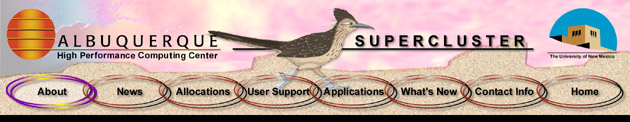](https://web.archive.org/web/20000517155459/http://www.alliance.unm.edu:80/Images/Supercluster_Banner.jpg){target=_blank}

*Banner of the Alliance/UNM Roadrunner Linux supercluster site, 2000.*

**Roadrunner (1999).** An Alta Technology "AltaCluster" (Alta Tech of
Sandy, Utah, later Linux Networx): 64 nodes of dual 450 MHz Pentium II,
512 MB ECC SDRAM and a 6.4 GB disk per node, a Myrinet data network and a
Fast Ethernet control network. Peak was 63 GFLOPS and nodes cost under
$6,500 each.[^bader-alliance-1999] Nodes arrived Mar 17 and Mar 31, 1999;
users got access Jun 1 and national allocations started Jul 1. NCSA
allocated $400,000 for Phase 2.[^arxiv-linux] It ran Linux, PBS and
Globus,[^bader-iwcc-1999] and was the first Linux cluster available
through NSF national allocation.[^carc-history] AHPCC's 2000 history dates
the Alliance funding to January 1999 and the unveiling to April
1999.[^ahpcc-2000] A 2000 news story puts the system's price at $400,000.[^alliance-cnet-2000]
It is last listed in Aug 2003 and is gone from the machine list by Nov
2003.[^hpcerc-2003][^hpc-roadrunner-2003][^hpc-machines-2003]

[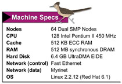](https://web.archive.org/web/20000516203849/http://www.alliance.unm.edu:80/Images/Machine_Specs.jpg){target=_blank}

*Roadrunner's specifications as the Alliance site showed them in 2000: 64
dual SMP nodes, 128 Pentium II 450 MHz processors, Fast Ethernet and
Myrinet, Red Hat Linux 6.1.*

**BlackBear.** A 16-node VA Linux cluster of dual 550 MHz Pentium III with
512 MB per node, Myrinet and Ethernet. AHPCC's hardware page says it was
"named in honor of Smokey the Bear", the New Mexico native who became the
fire-prevention mascot; the black bear is also the state
animal.[^arxiv-linux][^ahpcc-blackbear] The April 2003 HPCERC inventory lists it as a VA
Linux 501 cluster with a Pentium II 450 MHz head node and 16 dual Pentium
III 550 MHz compute nodes.[^hpcerc-2003] Peak (est.): about 18 GFLOPS.
Install date and funding: unknown.

**Vista Azul (2000).** Announced Dec 13, 1999 as an IBM Shared University
Research award: an AIX RS/6000 SP (**Vista**) coupled to a Linux Netfinity
cluster (**Azul**), with parallel storage, a prototype IBM Research
Scalable Graphics Engine and links to Roadrunner.[^bader-ibm-1999] The
plaque gives Vista as 8 four-way SMP nodes with 2 GB each, AIX 4.3 and an
SP Switch, and Azul as 8 four-way Netfinity nodes with 2 GB each, Debian
Linux and Gigabit Ethernet.[^plaques] The April 2003 HPCERC inventory
adds that Vista's nodes used 332 MHz PowerPC processors and ran the LSF
scheduler (access for "HPCERC & IBM"), and that Azul was IBM Netfinity
5500 servers with 550 MHz Xeon compute processors and a 700 MHz Xeon head
node with 4 GB.[^hpcerc-2003] The proposal (Dec 1, 1999) names six PIs:
Susan Atlas, David Bader, Robert Ballance, Thomas Caudell, Brian Smith and
John Sobolewski; CARC's history names Smith as PI.[^vista-azul-proposal][^carc-history]
Azul's nodes arrived Dec 16, 1999 and were running by Jan 5,
2000.[^vista-azul-status] The 2001 "32-node IBM SP3" on AHPCC's About page
is Vista (8 nodes × 4 processors). Azul was still listed in Dec 2006 as the
lab machine for UNM's parallel-programming classes, and Vista's compute
nodes went down on Jul 2, 2008 and stayed down.[^hpc-machines-2006][^hpc-irs-2010]
Peak (est.): about 21 GFLOPS for Vista (32 × 332 MHz × 2 flops per cycle)
plus about 18 GFLOPS for Azul (32 × 550 MHz). SUR dollar value: unknown.

**Los Lobos (2000).** 256 IBM Netfinity 4500R servers with dual 733 MHz
Pentium III (512 processors), 1 GB per node, Myrinet, the Maui scheduler,
1 TB of SSA RAID and 2 TB of tape.[^bader-lobos-2000][^bader-concurrency-2000]
[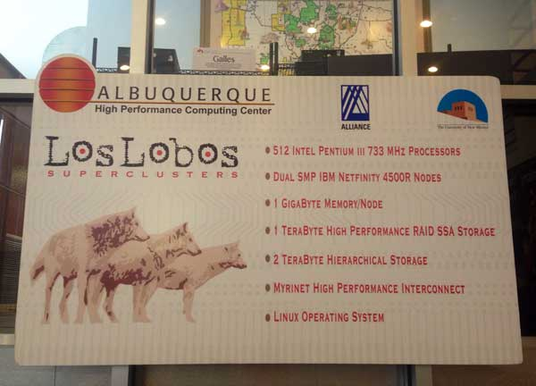](https://web.archive.org/web/20150926122508/http://www.ahpcc.unm.edu/common/images/loslobos.jpg){target=_blank}

*The Los Lobos sign, from the center's website (captured 2015).*

It was IBM's first Linux production system and the top open Linux cluster
on the TOP500.[^carc-history] TOP500 lists Rpeak 375.3 GFLOPS and Rmax 237
GFLOPS, ranked #80 (Nov 2000), #101, #125, #228 and #297 (Nov
2002).[^top500] A Reuters projection of "No. 24" was based on peak, not a
listed rank.[^bader-reuters-2000] Funded and supported by NSF through the
National Computational Science Alliance.[^bader-opening-2000] The money came
through NCSA's Alliance cooperative agreement (NSF ACI-9619019), which does
not itemize subawards; no UNM award record exists.[^nsf-9619019] Alliance
allocations started Sep 1, 2000.[^ahpcc-lobos-2000] It was still running in
Nov 2005 and Aug 2007, and is gone from the systems table by Aug
2008.[^hpc-move-2005][^hpc-outage-2007][^hpc-systems-2008] Cost: unknown. The
April 2003 HPCERC inventory still lists it: 4 head and 256 compute nodes,
730 MHz Pentium III, 1 GB per node, Myrinet, 2 TB NFS and PBS Pro, open to
"HPCERC & Alliance" users.[^hpcerc-2003]

**Other AHPCC systems.** BlackBear was in service by Feb 2000, when users
of the retiring SP2 were sent to it; it is still on the May 2004 machine
list, and by Nov 2005 its rack held only infrastructure
servers.[^ahpcc-nl-2000][^hpc-machines-2004][^hpc-move-2005] In 2001 AHPCC
counted four Linux superclusters: Los Lobos, Roadrunner, BlackBear and
Azul.[^ahpcc-systems-2000] The 1998–2000 systems pages also list SGI and
IBM workstations named for New Mexico places: **Cochiti** (SGI Onyx, 4 ×
R4400), **Belen** (SGI Octane) and the RS/6000s **Isleta**, **Grants**,
**Quemado**, **Acoma** and **Gallup**.[^ahpcc-systems-1998][^ahpcc-systems-2000]
The April 2003 inventory lists three smaller machines:[^hpcerc-2003]

* **Truchas**: 12 home-built Linux workstations with dual 650 MHz Pentium
  III and 1 GB each, running Condor. It was an upgrade of an older AHPCC
  cluster called Turing (12 Pentium MMX 233 MHz nodes in
  1998).[^ahpcc-turing][^ahpcc-systems-1998] The Truchas boxes were still in
  use in 2007.[^hpc-outage-2007]
* **RCDE**: 64 VA Linux 501 workstations (single 330 MHz Pentium II, 128
  MB) running Linux and Windows 2000.
* **Nambe**: an SGI Onyx2 visualization engine with 8 MIPS R10000 195 MHz
  processors and 1 GB, running IRIX.

The inventory's description column ("used for UNM classes", "joint project
with the UNM Center for Particle Physics", "staff desktops and Condor")
does not line up cleanly with the machine columns, so which use belongs to
which machine is not certain. Install and retirement dates: unknown.

**Access Grid (1999).** UNM installed an Access Grid node and hosted the
first-ever Access Grid session.[^carc-history] Hardware and cost: unknown.

[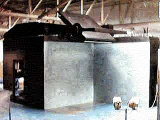](https://web.archive.org/web/20000903054128/http://www.ahpcc.unm.edu:80/Images/Photos/RAVE.jpg){target=_blank}
[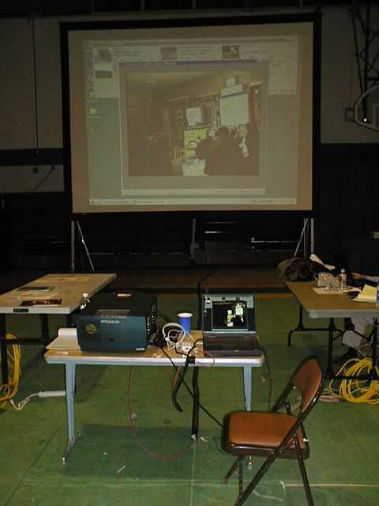{ width="240" }](https://web.archive.org/web/20020401140109/http://www.ahpcc.unm.edu:80/Images/Photos/DineNode.JPG){target=_blank}

*Left: the RAVE visualization system pictured on the AHPCC site in 2000;
it belonged to Los Alamos, was stored in AHPCC's high bay, and went back
to Los Alamos on Jul 18, 2000.[^ahpcc-rave]
Right: an Access Grid node at Diné College, pictured on the AHPCC site in
2002.*

**Conflicting dates in the sources.** The archived pages do not always
agree. Roadrunner's arrival is given as January 1999 (when funded) or
April 1999 (when unveiled); Los Lobos's processors as 733 MHz or 730 MHz,
and its start as summer or August 2000; and HPCERC's founding as 1994 or
1995.[^ahpcc-2000][^hpcerc-2003][^carc-history] This page uses the
earliest dated primary source for each.

### HPC@UNM era (2003–2009)

**Delphi (2003).** An IBM xSeries 342 parallel Oracle server: four 2-way
1 GHz Pentium III nodes, FAStT500 Fibre Channel storage with 2 TB raw, and
Red Hat Linux Advanced Server 2.1, for the Shared Resource for
Bioinformatics and Computational Biology.[^plaques] It hosted the UNM
Cancer Center's GenomeDW genomics data warehouse.[^carc-history] In Oct
2003 the database page listed Delphi1–3 as an Oracle RAC (2 × 1 GHz, 2 GB
each, 3 TB of Fibre Channel disk) and Delphi4 as its application server,
alongside an Oracle server called **Oro**.[^hpc-db-2003] The UNM Cancer
Center's Delphi/Apollo clusters are still on CARC's systems page in Apr
2015 but only Apollo is by Sep 2016.[^carc-systems-2015][^carc-systems-2016]
The Keck Foundation cancer-genomics grant of 2000 is the earliest record of
the center's genomics work.[^keck-2000] Peak (est.): about 8 GFLOPS.
Funding and cost: unknown.

**Rio Bravo (CREATE, 2004).** A TeraScan MODIS and AVHRR processing system
on a 5-node dual-Xeon cluster with 10 GB RAM and 20 TB NAS RAID, for the
Center for Rapid Environmental Assessment and Terrain Evaluation (CREATE),
with EDAC.[^plaques] NASA awarded $1.78M in Sep 2003, mostly for the
satellite receiving dish, with operations expected by April 2004; another
$1.2M was being sought.[^lobo-2003] CREATE ran at CARC for 17 years and
ended in 2021; NASA's LANCE now provides a similar service.[^carc-history]
Peak (est.): about 50 GFLOPS. When the processing cluster itself was
replaced is unknown. CARC's 2015 systems page also lists two CREATE
machines, **Fluvial** and **Ubik**, running TeraScan for Louis Scuderi's
group.[^carc-systems-2015]

**Pequin and Poblano (c. 2005).** NSF MRI award **DBI-0420513**,
"Acquisition of a High Performance Shared-Memory Computer for
Computational Science and Engineering at the University of New Mexico":
$350,378, awarded Aug 24, 2004 for Sep 2004–Aug 2007. PI Hua Guo; co-PIs
Marc Ingber, Susan Atlas, David Bader and Tudor Oprea, the same five PIs
named on both plaques.[^nsf-0420513][^bader-mri-2004] **Pequin** was an
IBM p550, a 4-processor dual-core POWER5 SMP with 16 GB RAM, and
**Poblano** an IBM p570, a 16-processor dual-core POWER5 SMP with 256 GB
RAM, both running AIX 5.3.[^plaques] Only the plaques link these two
machines to the award. The 2008 HPC@UNM systems table lists Pequin with
4 POWER5 processors at 1.5 GHz and Poblano with 16 at 1.9 GHz and 256
GB.[^hpc-systems-2008] Both were moved into the new machine room in Nov
2005 and were still up in Jun 2010; Pequin is marked decommissioned in Apr
2013, while Poblano is still up.[^hpc-move-2005][^hpc-irs-2010][^hpc-irs-2013]
The 2013 systems table gives their peaks as 12 GFLOPS (Pequin) and 61
GFLOPS (Poblano).[^hpc-systems-2013] The name
Poblano was later reused for a 64-core Silicon Mechanics AMD Opteron 6272
server (0.179 TFLOPS) listed in 2015.[^carc-systems-2015]

**Ristra (c. 2005).** An IBM BladeCenter JS20 with 96 blades, each with two
PowerPC 970 processors and 4 GB RAM, over Myrinet 2000 and Gigabit
Ethernet. Funded by the US Army; PIs Marc Ingber and C. Randall Truman
(Mechanical Engineering).[^plaques] The 2008 systems table lists one head
node and 95 compute blades with 1.6 GHz PowerPC 970
processors.[^hpc-systems-2008] Peak (est.): about 1.2 TFLOPS (192
processors × 1.6 GHz × 4 flops per cycle), which the 2013 systems table
confirms as 1,200 GFLOPS; likely UNM's first teraflop-class
machine.[^hpc-systems-2013] Tim Thomas "completed negotiations for the next
large MPI cluster" in 2004, which may be Ristra (inferred).[^physics-2004]
It was first housed outside the Galles Building and moved into the new
machine room on Nov 9, 2005; it kept running through Jun 2010 and is marked
decommissioned in Apr 2013.[^hpc-move-2005][^hpc-outage-2010][^hpc-irs-2013]
Army award number and cost: unknown.

**Hammer (c. 2005).** An Apple Xserve G5 cluster of 16 dual-G5 nodes with
2 GB per node, InfiniBand and Mac OS X 10.4 "Tiger". Funded by the US
Army; PIs Ingber and Truman.[^plaques] HPC@UNM's 2010 description says it
was bought "on the same grant as Ristra" and that "the primary PI is Marc
Ingber".[^hpc-hammer-2010] The 2008 systems table lists 2 GHz G5
processors.[^hpc-systems-2008] Tiger shipped in April 2005, so it was
installed no earlier than then (inferred), and like Ristra it was outside
the Galles Building until Nov 2005.[^hpc-move-2005] Peak: 256 GFLOPS (2013
systems table).[^hpc-systems-2013] It was up in Jun 2010 and is marked
decommissioned in Apr 2013.[^hpc-irs-2010][^hpc-irs-2013] Cost: unknown.

**Yenta (c. 2006).** An Apple Xserve G5 cluster of 16 dual-G5 nodes with 2
GB per node and a 20 TB SAN RAID, running Mac OS X Tiger, for the ARTS Lab
(Director Edward Angel).[^plaques] The ARTS Lab opened in Dec 2005 with
about $2.5–3M from the state's Media Industries Strategic
Project.[^lobo-2005][^cs-2005] Yenta was already running in Nov 2005, when it
was moved from the Roadrunner room into the new machine room, and it is
still listed as up in Apr 2013.[^hpc-move-2005][^hpc-irs-2013] Peak (est.):
256–294 GFLOPS. Cost: unknown.

**Nano (by 2008).** A Dell PowerEdge 1950 cluster with one head node and
36 compute nodes of Xeon 5140 (2.33 GHz dual-core) and
Myrinet.[^hpc-systems-2008] The 2015 systems page lists 35 nodes, 140
cores and 1.288 TFLOPS peak.[^carc-systems-2015] It is first named in an
Aug 2007 maintenance notice and is still listed in Sep 2016.[^hpc-outage-2007][^carc-systems-2016]
Funding, cost and retirement: unknown.

**Pequeña (by 2008).** An SGI Altix ICE with one head node and 22 compute
nodes of quad-core Xeon X5355/X5365 and InfiniBand.[^hpc-systems-2008] It
was also the gateway to Encanto, the state's NMCAC supercomputer.[^hpc-outage-2010] In
2015 it had 176 cores and 2.1 TFLOPS peak.[^carc-systems-2015] Replaced by
Wheeler Phase 1 in 2017.[^carc-wheeler] Funding and cost: unknown.

### CARC era (2009–today)

**HP X9000 storage (2010).** 281 TB (RAID 5 usable), bought by the UNM
Research Storage Consortium (four NSF projects plus University Libraries).
It was then the most densely populated HP storage system in the
world.[^carc-history][^atlas-deck]

**Metropolis (2012–2017).** A repurposed LANL supercomputer donated by the
New Mexico Consortium (NMC) under the NSF PRObE project (NMC award CNS-1042537, PI Gary Grider; CARC's Timothy Thomas was a co-PI).[^carc-history][^nsf-probe][^nsf-1042537] The 2015 systems page lists it
as a Linux Networx Evolocity cluster of 70 nodes with AMD Opteron 252
processors (140 cores, 0.728 TFLOPS).[^carc-systems-2015] Replaced by
Wheeler Phase 1 in 2017.[^carc-wheeler]

**Other CARC-era systems.** CARC's 2015–2016 systems pages also list
research-group and service machines: **m3** (an ATLAS / Open Science Grid
gateway), **Rio Rancho** (16 nodes, from 2006), **Anodyne**, **Synergy**,
**Zeno**, **Deepthought** (an OpenStack/Ceph cluster), the LWA data archive
and the ARTS Lab's SkyScan dome cluster.[^carc-systems-2015][^carc-systems-2016][^hpc-irs-2013]
CARC said in 2013 that it had "about 5 Tflops/sec (peak) of computing power
and just under 100 TB of storage".[^hpc-systems-2013]

**Galles (2013–2019).** A 200-node "green" Beowulf cluster with a Hadoop
subsystem, built from more than 200 used Dell desktops collected across
campus with UNM IT and University Libraries. It was retired after the
late-May 2019 downtime because it had become hard to
maintain.[^carc-history][^carc-upgrades-2019] The 2015 systems page lists
200 Dell OptiPlex nodes, 400 cores and 2.2 TFLOPS.[^carc-systems-2015]

**Ulam (2014–2017).** 120 AMD nodes (960 cores) with InfiniBand in 12–13
racks, donated by NMC. Shipments arrived Dec 2013 and Jan 16, 2014, and
the first two racks (144 cores) came up in early 2014.[^unm-ulam-2014]
CARC's aggregate reached 2,200 cores and 15 TFLOPS peak.[^carc-history]
The 2015 systems page lists it as IBM System x3755 nodes with AMD 8214
processors and 4.2 TFLOPS peak.[^carc-systems-2015]
The rest of Ulam waited on the 2015 machine-room upgrade (just over
$250K).[^lobo-2015] Replaced by Wheeler Phase 2 in Fall
2017.[^carc-wheeler]

**Gibbs.** 24 Dell PowerEdge R620 nodes with Xeon E5-2670 2.6 GHz (384
cores), QDR InfiniBand and Scientific Linux; 3.996 TFLOPS
peak.[^legacy-specs] It is first listed on the 2015 systems page, with
the same 3.996 TFLOPS.[^carc-systems-2015] The machine-state page already
shows it up, with 26 nodes, in Apr 2013.[^hpc-irs-2013] Install date and
funding: unknown. Retired by 2026.

**Xena (c. 2014–2026).** NSF MRI **ACI-1040530**, "MRI: Acquisition of a
GPU-Accelerated Parallel Supercomputer": $435,077 for Sep 2010–Aug 2015.
PI Susan Atlas; co-PIs Hua Guo, Timothy Thomas and Lydia Tapia; former
co-PIs Pradeep Sen and Jamesina Simpson. The award was meant to raise
CARC's peak from 5 to 41 TFLOPS.[^nsf-1040530] As built: 32 Dell
PowerEdge R730/R930 nodes (576 cores) with Xeon E5-2640 and E7-4809, 24
single-K40M and 4 dual-K40M GPU nodes, two 1 TB and two 3 TB big-memory
nodes, FDR InfiniBand and 18 TFLOPS peak.[^legacy-specs] In 2011 CARC
planned it as a "Fermi Tesla GPU supercomputer" for Spring
2011.[^hpc-xena-2011] In Jul 2014 and again in Sep 2015 CARC's home page
said it "will come online this summer", and the Sep 2015 project page still
describes it in the future tense.[^carc-home-2014][^carc-xena-2015] It is first
listed as a production system in Sep 2016, so it entered service between
late 2015 and Sep 2016.[^carc-systems-2016] Retired in 2026. Before Xena,
CARC's only accelerator system was **Bethe**, a Xeon Phi and NVIDIA GTX
Titan machine for astrophysics and nanoscience code development, listed
from Jul 2014.[^carc-home-2014][^carc-systems-2015]

[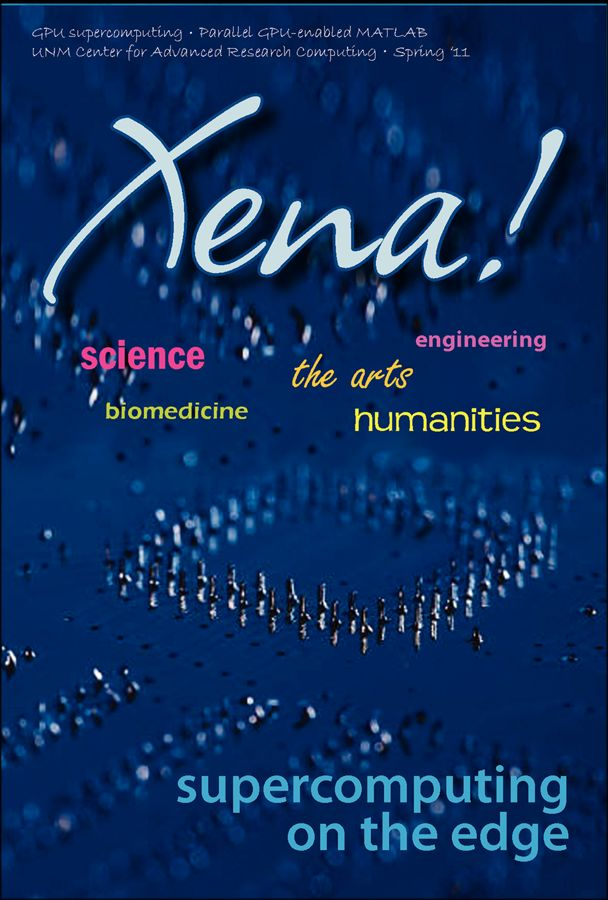{ width="320" }](https://web.archive.org/web/20110718031120/http://www.hpc.unm.edu/images/xena-4-x-6-bradley-hand.png){target=_blank}

*A Xena postcard from the center's website (captured July 2011), when Xena
was still planned as a Fermi-based GPU system.*

[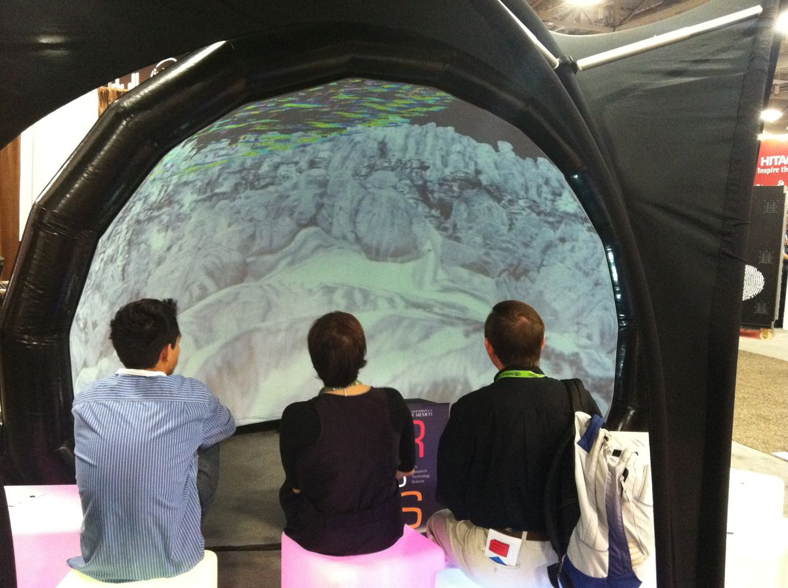](https://web.archive.org/web/20151001114149/http://www.hpcerc.unm.edu/common/images/sc12-gridjam.jpg){target=_blank}

*GridJam at the SC12 conference (2012), from the CARC website.*

[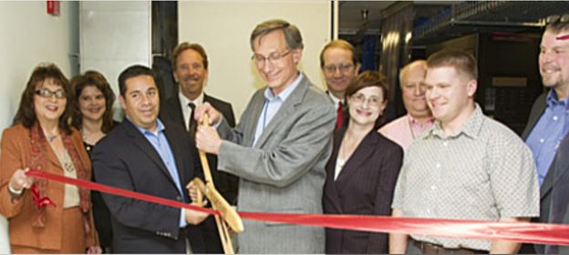](https://web.archive.org/web/20151001023939/http://www.hpcerc.unm.edu/common/images/ribboncutting.jpg){target=_blank}

*A ribbon cutting at CARC, from the center's website (captured 2015; the
event and date are not captioned there).*

**Wheeler (2017–c. 2025).** Donated by LANL through NMC and PRObE,
announced Mar 16, 2017 as more than 500 nodes of dual quad-core Xeon 5550
(45–50 TFLOPS), "nine times" the four machines it
replaced.[^hpcwire-2017] Named for Wheeler Peak; Phase 1 (144 nodes)
replaced Metropolis and Pequeña and Phase 2 (Fall 2017) replaced
Ulam.[^carc-wheeler] As deployed: 304 diskless SGI Altix XE nodes (2,432
cores), QDR InfiniBand, 25 TFLOPS peak.[^legacy-specs] Replaced by
Easley.[^carc-easley]

**Taos (condo).** 9 Dell PowerEdge R630 nodes with Xeon E5-2698 v4 (180
cores) and FDR InfiniBand.[^legacy-specs] In Oct 2020 "CARC and several UNM
PIs began acquiring new hardware to expand the Taos compute
cluster."[^iab-2020] Peak (est.): about 6 TFLOPS. Dates and PIs: unknown.

**Hopper (2022–present).** CARC's first large condo cluster. The base
system (14 nodes of 32 cores and 700 TB of storage) was ordered from Dell
in late 2021, its cost split half PIs and half OVPR.[^iab-2021] It
launched with 53 nodes, about 1,760 cores and 8.2 TB RAM; OVPR funded the
free nodes and PIs such as Melanie Moses bought priority
nodes.[^carc-hopper] Today: Dell PowerEdge R640/R740 with Xeon Gold
6226R/6242, 61 nodes, 2,176 cores, 37 NVIDIA A100 GPUs and HDR
InfiniBand.[^facilities] Peak (est.): about 0.2 PFLOPS CPU plus about
0.36 PFLOPS FP64 from the A100s. Cost: unknown.

**Easley (2025–present).** Named for NASA mathematician and programmer
Annie Easley. A Dell CPU/GPU cluster with NVIDIA networking and IBM
storage that replaced Wheeler with "7–10×" the performance in a fifth of
the racks.[^carc-easley] It has 65 nodes, 4,160 cores and 23.3 TB RAM,
with 36 NVIDIA L40S and 8 NVIDIA H100 GPUs, an NDR 800 Gbps InfiniBand
core, and 720 TB of all-flash IBM Storage Scale.[^facilities] CARC
described it as a purchase of "next-generation computing systems"; no
external grant was found.[^carc-director-2025] Peak (est.): about 0.27
PFLOPS CPU (Xeon Gold 6438Y+) plus about 0.27 PFLOPS FP64 from the
H100s (twice that with FP64 tensor cores) and about 0.05 PFLOPS from the
L40S. Cost: unknown.

**Next system (2026).** NSF MRI **2511915**, "Equipment: MRI: Track 1
Acquisition of a High-Performance GPU Compute Cluster for Quantum- and
AI-driven Chemistry and Materials Research": $1,399,999 starting Mar 15,
2026. PI Susan Atlas; co-PIs Hua Guo, Ivan Deutsch, Patrick Bridges and
Yi He.[^nsf-2511915] Name and specs: not yet published.

## Open questions

These gaps need someone with first-hand knowledge. The 1997–2005
snapshots of `arc.unm.edu` in the Internet Archive have not been checked
yet and may help with the earliest machines.

* Exact retirement dates for the SP1, Nambe, BlackBear, Los Lobos, Azul,
  Poblano, Yenta, Nano and Delphi. The archive narrows each to a range
  (see the machine notes) but no decommission notice was found.
* The dates Marc Ingber directed AHPCC before Brian Smith, and the dates
  of Smith's own term. The only source for Ingber's earlier term is one
  undated page.
* The Army award numbers and costs for Ristra and Hammer, and Yenta's
  cost. No Army award record was found.
* The exact month Xena entered production (between late 2015 and Sep 2016),
  and when Nano, Pequeña and Gibbs were installed.
* The name "Rio Bravo" appears only on the plaque; the center's own pages
  call the CREATE cluster "riobravo" or "SeaSpace cluster".
* The actual decommission dates of Wheeler, Taos, Gibbs and Xena.
* Purchase costs for Hopper, Easley and the BeeGFS, IBM and NetApp storage.
* Condo PIs on Taos and Hopper beyond those named here.
* Term end dates for the associate and deputy directors.

## Sources

[^carc-history]: UNM CARC, [History](https://carc.unm.edu/about/history/){target=_blank} (also at [carc.unm.edu/about-carc/history.html](https://carc.unm.edu/about-carc/history.html){target=_blank}).
[^plaques]: HPC@UNM machine plaques, Galles Building machine room, photographed Jul 1, 2026 (image above).
[^bader-1999]: UNM, "UNM dedicates Roadrunner" (Apr 5, 1999), [davidbader.net/post/19990405-unm](https://davidbader.net/post/19990405-unm/){target=_blank}.
[^top500-1995]: TOP500 1995 report, MHPCC center description, [netlib.org](https://netlib.org/benchmark/top500/reports/report95/Centers/node14.html){target=_blank}.
[^newswise-1998]: UNM, "Maui High Performance Computing Center to increase computing capacity by 50 percent" (Jan 12, 1998), [newswise.com](https://www.newswise.com/articles/maui-high-performance-computing-center-to-increase-computing-capacity-by-50-percent-with-new-technology){target=_blank}.
[^arxiv-linux]: "Linux and High-Performance Computing", [arXiv:2603.22495](https://arxiv.org/pdf/2603.22495){target=_blank}.
[^bader-ncsa-1999]: NCSA Access (Apr 20, 1999), [davidbader.net/post/19990420-ncsaaccess](https://davidbader.net/post/19990420-ncsaaccess/){target=_blank}.
[^evl-1999]: EVL, Alliance Chautauqua '99, [evl.uic.edu/events/346](https://www.evl.uic.edu/events/346){target=_blank}.
[^bader-ibm-1999]: IBM, Vista Azul SUR announcement (Dec 13, 1999), [davidbader.net/post/19991213-ibm](https://davidbader.net/post/19991213-ibm/){target=_blank}.
[^bader-lobos-2000]: UNM, Los Lobos announcement (Mar 21, 2000), [davidbader.net/post/20000321-unm](https://davidbader.net/post/20000321-unm/){target=_blank}.
[^bader-concurrency-2000]: IEEE Concurrency (Apr 2000), [davidbader.net/post/20000401-ieeeconcurrency](https://davidbader.net/post/20000401-ieeeconcurrency/){target=_blank}.
[^bader-opening-2000]: HPCERC, Los Lobos grand opening invitation (Sep 13, 2000), [davidbader.net/post/20000808-hpcerc](https://davidbader.net/post/20000808-hpcerc/){target=_blank}.
[^bader-briefing-2000]: HPCwire, IBM Linux Supercluster Briefing Center (Sep 15, 2000), [davidbader.net/post/20000915-hpcwire](https://davidbader.net/post/20000915-hpcwire/){target=_blank}.
[^bader-reuters-2000]: Reuters (Mar 23, 2000), [davidbader.net/post/20000323-reuters](https://davidbader.net/post/20000323-reuters/){target=_blank}.
[^hpcerc-2003]: HPCERC, "Technical Summary & Software Inventory" (captured Apr 16, 2003), [web.archive.org](https://web.archive.org/web/20030416160312/http://www.hpcerc.unm.edu/computing/docs/systems.html){target=_blank}.
[^ahpcc-2000]: AHPCC, "History" (captured Aug 17, 2000), [web.archive.org](https://web.archive.org/web/20000817235728/http://www.ahpcc.unm.edu:80/About/History.html){target=_blank}.
[^hpcerc-1998]: HPCERC, "About HPCERC" (captured Mar 1, 2000), [web.archive.org](https://web.archive.org/web/20000301011731/http://hpcerc.unm.edu:80/about_hpcerc.html){target=_blank}.
[^hpcerc-2003-about]: HPCERC, "About" (captured Feb 12, 2003), [web.archive.org](https://web.archive.org/web/20030212103056/http://www.hpcerc.unm.edu:80/about/index.html){target=_blank}.
[^hpcerc-2003-dir]: HPCERC, staff directory (captured Apr 16, 2003), [web.archive.org](https://web.archive.org/web/20030416154123/http://www.hpcerc.unm.edu:80/about/contacts/directory.htm){target=_blank}.
[^ahpcc-org-2000]: AHPCC, organization chart (captured Aug 17, 2000), [web.archive.org](https://web.archive.org/web/20000817235734/http://www.ahpcc.unm.edu:80/Images/Graphics/AHPCC_Org_Chart.gif){target=_blank}.
[^hpc-org-2007]: HPC@UNM, organization chart (captured Mar 13, 2007), [web.archive.org](https://web.archive.org/web/20070313102152/http://www.hpc.unm.edu:80/info/staff-information/OrgChart.png){target=_blank}.
[^ahpcc-blackbear]: AHPCC, BlackBear hardware page (captured Jan 28, 2001), [web.archive.org](https://web.archive.org/web/20010128194600/http://www.ahpcc.unm.edu:80/Systems/Hardware/Blackbear/index.html){target=_blank}.
[^ahpcc-turing]: AHPCC, Turing hardware page (captured Aug 17, 2000), [web.archive.org](https://web.archive.org/web/20000817235151/http://www.ahpcc.unm.edu:80/Hardware/Turing.html){target=_blank}.
[^hpc-systems-2008]: HPC@UNM, systems table (captured Aug 20, 2008), [web.archive.org](https://web.archive.org/web/20080820064512/http://www.hpc.unm.edu/systems-table){target=_blank}.
[^hpc-hammer-2010]: HPC@UNM, Hammer description (captured Jun 11, 2010), [web.archive.org](https://web.archive.org/web/20100611023154/http://www.hpc.unm.edu/services/machines/hammer/hammer-descripition){target=_blank}.
[^carc-systems-2015]: CARC, "Systems" (captured Apr 20, 2015), [web.archive.org](https://web.archive.org/web/20150420043138/http://www.carc.unm.edu:80/systems-software/systems.html){target=_blank}.
[^carc-systems-2016]: CARC, "Systems" (captured Sep 20, 2016), [web.archive.org](https://web.archive.org/web/20160920212936/http://www.carc.unm.edu:80/systems-software/systems.html){target=_blank}.
[^top500]: TOP500, [Los Lobos system page](https://www.top500.org/system/167391){target=_blank}.
[^bader-alliance-1999]: Roadrunner presentation to the Alliance (May 12, 1999), [PDF](https://davidbader.net/events/19990512-alliance/19990512-Alliance.pdf){target=_blank}.
[^bader-iwcc-1999]: Bader, Maccabe, Mastaler, McIver and Kovatch, "Design and analysis of the Alliance/University of New Mexico Roadrunner Linux SMP SuperCluster", IWCC 1999, [doi:10.1109/IWCC.1999.810804](https://doi.org/10.1109/IWCC.1999.810804){target=_blank}.
[^bader-hpcwire-1999]: HPCwire (Jul 23, 1999), [davidbader.net/post/19990723-hpcwire](https://davidbader.net/post/19990723-hpcwire/){target=_blank}.
[^bader-hpc-2003]: UNM, HPC@UNM leadership announcement (Sep 5, 2003), [davidbader.net/post/20030905-unm-hpc](https://davidbader.net/post/20030905-unm-hpc/){target=_blank}.
[^lobo-2003]: Daily Lobo, "Grant will bring project to UNM" (Sep 25, 2003), [dailylobo.com](https://www.dailylobo.com/article/2003/09/grant_will_bring_project_to_unm){target=_blank}.
[^physics-2004]: UNM Physics and Astronomy, Tim Thomas named Deputy Director (Oct 26, 2004), [physics.unm.edu](https://physics.unm.edu/news/2004/10/thomas_20041026.html){target=_blank}.
[^nsf-0420513]: NSF award [DBI-0420513](https://api.nsf.gov/services/v1/awards/0420513.json){target=_blank}.
[^bader-mri-2004]: UNM, MRI award release (Sep 21, 2004), [davidbader.net/post/20040921-unm-mri](https://davidbader.net/post/20040921-unm-mri/){target=_blank}.
[^lobo-2005]: Daily Lobo, ARTS Lab opening (Dec 2005), [dailylobo.com](https://www.dailylobo.com/article/2005/12/25_million_arts_lab_opens_doors){target=_blank}.
[^cs-2005]: UNM Computer Science, ARTS Lab (Sep 2005), [cs.unm.edu](https://www.cs.unm.edu/news/2005/09/arts-lab.html){target=_blank}.
[^engr-2007]: UNM Engineering, "Prof. Caudell to direct Center for High Performance Computing" (Jan 2007), [engineering.unm.edu](https://engineering.unm.edu/news/2007/01/prof.-caudell-to-direct-center-for-high-performance-computing.html){target=_blank}.
[^physics-2009]: UNM Physics and Astronomy, Atlas named CARC Director (Jun 1, 2009), [physics.unm.edu](https://physics.unm.edu/news/2009/06/advanced_research_20090601.html){target=_blank}.
[^nsf-1040530]: NSF award [ACI-1040530](https://api.nsf.gov/services/v1/awards/1040530.json){target=_blank}, including the project outcomes report.
[^atlas-deck]: S. R. Atlas, CARC overview slides, [srccii.cac.cornell.edu](https://srccii.cac.cornell.edu/Decks/Atlas.pdf){target=_blank}.
[^nsf-probe]: NSF PRObE awards CNS-1042537 (New Mexico Consortium) and CNS-1042543 (Carnegie Mellon), [api.nsf.gov](https://api.nsf.gov/services/v1/awards.json?keyword=%22Parallel%20Reconfigurable%20Observational%20Environment%22){target=_blank}.
[^unm-ulam-2014]: UNM Engineering, "UNM gains supercomputer from the New Mexico Consortium" (Feb 24, 2014), [engineering.unm.edu](https://engineering.unm.edu/news/2014/02/unm-gains-supercomputer-from-the-new-mexico-consortium.html){target=_blank}.
[^ladp-2014]: Los Alamos Daily Post, "NMC gives UNM large-scale computer system", [ladailypost.com](https://ladailypost.com/%ef%bb%bfnmc-gives-unm-large-scale-computer-system-for-science-and-engineering-research/){target=_blank}.
[^lobo-2015]: Daily Lobo, "New supercomputer" (Jan 22, 2015), [dailylobo.com](https://www.dailylobo.com/article/2015/01/2015-01-22-new-supercomputer){target=_blank}.
[^hpcwire-2017]: HPCwire, LANL donates Wheeler to UNM (Mar 16, 2017), [hpcwire.com](https://www.hpcwire.com/?p=34676){target=_blank}.
[^carc-wheeler]: CARC, "CARC system gets a name" (2017), [carc.unm.edu/news/wheeler-named](https://carc.unm.edu/news/wheeler-named/){target=_blank}.
[^carc-upgrades-2019]: CARC, "Upgrades at CARC" (Jun 2019), [GitHub](https://github.com/UNM-CARC/unm-carc.github.io/blob/main/docs/news/carc-upgrades.md){target=_blank}.
[^iab-2020]: CARC Internal Advisory Board minutes (Oct 29, 2020), [PDF](https://carc.unm.edu/about-carc/minutes-iab-10-29-20.pdf){target=_blank}.
[^iab-2021]: CARC Internal Advisory Board minutes (Oct 28, 2021), [PDF](https://carc.unm.edu/about-carc/minutes-iab-10-28-2021.pdf){target=_blank}.
[^carc-assoc-2021]: CARC, associate director announcement (2021), [carc-temp.unm.edu](https://carc-temp.unm.edu/news--events/News/carc-announces-associate-director.html){target=_blank}.
[^carc-hopper]: CARC, Hopper launch (2022), [carc.unm.edu/news/hopper-launch](https://carc.unm.edu/news/hopper-launch/){target=_blank}.
[^carc-easley]: CARC, Easley cluster announcement (2025), [carc.unm.edu/news/easley-cluster](https://carc.unm.edu/news/easley-cluster/){target=_blank}.
[^carc-director-2025]: CARC, director's message (2025), [carc-temp.unm.edu/news/director-message](https://carc-temp.unm.edu/news/director-message/){target=_blank}.
[^legacy-specs]: [Cluster specifications (legacy reference)](../systems/cluster-specifications.md).
[^facilities]: [Facilities description](facilities.md).
[^nsf-2511915]: NSF award [2511915](https://api.nsf.gov/services/v1/awards/2511915.json){target=_blank}.
[^carc-swetnam]: CARC, welcome to Director Swetnam, [carc.unm.edu/news/welcome-director-swetnam](https://carc.unm.edu/news/welcome-director-swetnam/){target=_blank}.
[^carc-personnel]: CARC personnel, [carc-temp.unm.edu/contact/personnel](https://carc-temp.unm.edu/contact/personnel/){target=_blank}.
[^carc-departures]: CARC, departures and retirements, [carc.unm.edu/news/departures-retirements](https://carc.unm.edu/news/departures-retirements/){target=_blank}.
[^charlotte-2026]: UNC Charlotte OneIT, new Director of Research Computing (Jun 2, 2026), [oneit.charlotte.edu](https://oneit.charlotte.edu/2026/06/02/new-director-of-research-computing/){target=_blank}.
[^ahpcc-about-old]: AHPCC, "About AHPCC" (undated page describing the 1997–98 lab, captured May 31, 2000), [web.archive.org](https://web.archive.org/web/20000531052008/http://www.ahpcc.unm.edu:80/homepage/About_AHP.html){target=_blank}.
[^ahpcc-systems-1998]: AHPCC, systems guide (updated Nov 24, 1998; captured Feb 5, 2001), [web.archive.org](https://web.archive.org/web/20010205084900/http://www.ahpcc.unm.edu:80/Guide/AHPCC_Systems.html){target=_blank}.
[^ahpcc-systems-2000]: AHPCC, "Computing Systems" (captured Aug 17, 2000), [web.archive.org](https://web.archive.org/web/20000817234838/http://www.ahpcc.unm.edu:80/Systems/){target=_blank}; and "About AHPCC" (captured May 29, 2001), [web.archive.org](https://web.archive.org/web/20010529134212/http://www.ahpcc.unm.edu:80/About/){target=_blank}.
[^ahpcc-nl-2000]: AHPCC user newsletters for [February 2000](https://web.archive.org/web/20010318123747/http://www.ahpcc.unm.edu:80/Systems/Newsletters/NewsletterFebruary.html){target=_blank} and [March 2000](https://web.archive.org/web/20010318135320/http://www.ahpcc.unm.edu:80/Systems/Newsletters/NewsletterMarch.html){target=_blank}.
[^ahpcc-expansion-2000]: AHPCC, building expansion release (captured Sep 3, 2000), [web.archive.org](https://web.archive.org/web/20000903052548/http://www.ahpcc.unm.edu:80/NewsPress/expansion.html){target=_blank}.
[^ahpcc-lobos-2000]: AHPCC, Los Lobos status update (Aug 21, 2000), [web.archive.org](https://web.archive.org/web/20010627214222/http://www.ahpcc.unm.edu:80/NewsPress/LosLobos_update_Aug21.html){target=_blank}.
[^ahpcc-rave]: AHPCC, RAVE hardware page (captured Feb 1, 2001), [web.archive.org](https://web.archive.org/web/20010201204000/http://www.ahpcc.unm.edu:80/Hardware/RAVE.html){target=_blank}.
[^ahpcc-news-2000]: AHPCC, News & Press index (captured Aug 17, 2000; the Keck item is dated Jul 31, 2000), [web.archive.org](https://web.archive.org/web/20000817234732/http://www.ahpcc.unm.edu:80/NewsPress/){target=_blank}.
[^keck-2000]: UNM HSC, "Collaboration in Cancer Genome Research at UNM and Sandia National Laboratories Supported by Million Dollar Grant" (Jul 2000; captured Jan 20, 2002), [web.archive.org](https://web.archive.org/web/20020120144902/http://www.ahpcc.unm.edu:80/NewsPress/keck.html){target=_blank}.
[^alliance-cnet-2000]: News story on Roadrunner and Los Lobos reposted on the Alliance site (captured Apr 18, 2000), [web.archive.org](https://web.archive.org/web/20000418203053/http://www.alliance.unm.edu:80/news/headlines/350387l.htm){target=_blank}.
[^vista-azul-status]: Vista Azul project status page (captured Sep 3, 2000), [web.archive.org](https://web.archive.org/web/20000903070825/http://www.ahpcc.unm.edu:80/projects/vista-azul/status.html){target=_blank}.
[^vista-azul-proposal]: "Development and Investigation of an Interoperable, Hybrid Technology System for Local/Remote Scientific and Visual Computing", IBM SUR proposal (Dec 1, 1999), [web.archive.org](https://web.archive.org/web/20010213223155/http://www.ahpcc.unm.edu:80/projects/vista-azul/proposal/index.html){target=_blank}.
[^vista-azul-people]: Vista Azul project contacts (captured Nov 19, 2002), [web.archive.org](https://web.archive.org/web/20021119221005/http://www.ahpcc.unm.edu:80/projects/vista-azul/people.html){target=_blank}.
[^hpc-dir-2003]: HPC@UNM staff directory (captured Jun 25, 2003), [web.archive.org](https://web.archive.org/web/20030625082135/http://www.hpc.unm.edu:80/about/contacts/directory.htm){target=_blank}.
[^hpc-dir-2004]: HPC@UNM staff directory (captured Feb 13, 2004), [web.archive.org](https://web.archive.org/web/20040213022148/http://www.alliance.unm.edu:80/center_information/staff_directory/index.html){target=_blank}.
[^hpc-dir-2006]: HPC@UNM staff directory (captured Sep 6, 2006), [web.archive.org](https://web.archive.org/web/20060906173030/http://www.alliance.unm.edu/center_information/staff_directory/index.html){target=_blank}.
[^hpc-staff-2013]: CARC staff directory (captured Apr 21, 2013), [web.archive.org](https://web.archive.org/web/20130421094936/http://www.hpc.unm.edu/info/staff-information/staff_directory){target=_blank}.
[^hpc-home-2012]: CARC home page (captured Jan 6, 2012), [web.archive.org](https://web.archive.org/web/20120106203200/http://www.hpc.unm.edu:80/){target=_blank}; the Nov 2013 home page names no deputy, [web.archive.org](https://web.archive.org/web/20131113184250/http://www.carc.unm.edu:80/){target=_blank}.
[^carc-staff-2015]: CARC staff page (captured Sep 21, 2015), [web.archive.org](https://web.archive.org/web/20150921012941/http://www.ahpcc.unm.edu/about/staff.html){target=_blank}.
[^carc-staff-2016]: CARC staff page (captured Sep 21, 2016), [web.archive.org](https://web.archive.org/web/20160921091745/http://www.carc.unm.edu:80/about/staff.html){target=_blank}.
[^hpc-roadrunner-2003]: HPC@UNM, Roadrunner page (captured Jul 25, 2003), [web.archive.org](https://web.archive.org/web/20030725190155/http://www.hpc.unm.edu:80/computing/roadrunner/index.html){target=_blank}.
[^hpc-machines-2003]: HPC@UNM, machine list (captured Nov 12, 2003), [web.archive.org](https://web.archive.org/web/20031112235535/http://www.hpc.unm.edu:80/computing_resources/systems/facilities/machines/list/index.html){target=_blank}.
[^hpc-machines-2004]: HPC@UNM, machine list (captured May 31, 2004), [web.archive.org](https://web.archive.org/web/20040531025356/http://www.hpc.unm.edu:80/computing_resources/systems/facilities/machines/list/){target=_blank}.
[^hpc-db-2003]: HPC@UNM, database servers (captured Oct 12, 2003), [web.archive.org](https://web.archive.org/web/20031012034234/http://www.hpc.unm.edu:80/computing_resources/systems/Database%20servers/index.htm){target=_blank}.
[^hpc-move-2005]: HPC@UNM, machine-room move and downtime log (Nov 7–28, 2005; captured Dec 28, 2005), [web.archive.org](https://web.archive.org/web/20051228112150/http://www.hpc.unm.edu:80/systems/downtime.html){target=_blank}.
[^hpc-machines-2006]: HPC@UNM, machines table (captured Dec 16, 2006), [web.archive.org](https://web.archive.org/web/20061216225746/http://www.hpc.unm.edu:80/services/machines){target=_blank}.
[^hpc-outage-2007]: HPC@UNM, Aug 2007 outage notice (captured Aug 15, 2007), [web.archive.org](https://web.archive.org/web/20070815223304/http://www.hpc.unm.edu:80/news/news/outage-aug-2007/){target=_blank}.
[^hpc-irs-2010]: CARC, machine-state page (captured Jun 10, 2010), [web.archive.org](https://web.archive.org/web/20100610100029/https://www.hpc.unm.edu/irs/public/machine_state.html){target=_blank}.
[^hpc-outage-2010]: CARC, Jun 2010 maintenance notice signed by Tim Thomas, "CARC Operations Director" (captured Jun 16, 2010), [web.archive.org](https://web.archive.org/web/20100616144145/http://www.hpc.unm.edu/news/news/outagejun2010){target=_blank}.
[^hpc-irs-2013]: CARC, machine-state page (captured Apr 21, 2013), [web.archive.org](https://web.archive.org/web/20130421095226/https://www.hpc.unm.edu/irs/public/machine_state.html){target=_blank}.
[^hpc-systems-2013]: CARC, systems table (captured Sep 9, 2013), [web.archive.org](https://web.archive.org/web/20130909010630/http://www.hpc.unm.edu/systems-table){target=_blank}.
[^hpc-xena-2011]: CARC, Xena announcement (captured Jul 18, 2011), [web.archive.org](https://web.archive.org/web/20110718030537/http://www.hpc.unm.edu/Xena){target=_blank}.
[^carc-home-2014]: CARC home page (captured Jul 19, 2014), [web.archive.org](https://web.archive.org/web/20140719120800/http://www.carc.unm.edu/){target=_blank}.
[^carc-xena-2015]: CARC, Xena project page (captured Sep 21, 2015), [web.archive.org](https://web.archive.org/web/20150921004526/http://www.ahpcc.unm.edu/research-collaboration/projects/xena.html){target=_blank}; and home page (captured Sep 7, 2015), [web.archive.org](https://web.archive.org/web/20150907045734/http://www.ahpcc.unm.edu/){target=_blank}.
[^carc-dmz-2014]: CARC, "UNM Establishes 'Science DMZ' Network Link for Genomics Research" (Aug 1, 2014), [web.archive.org](https://web.archive.org/web/20150906231453/http://www.carc.unm.edu/news/2014/08/science-dmz.html){target=_blank}.
[^carc-nsf-2014]: CARC, "National Science Foundation Awards" (Sep 5, 2014), [web.archive.org](https://web.archive.org/web/20150907010144/http://www.carc.unm.edu/news/2014/09/NSF%20Grant.html){target=_blank}.
[^nsf-1440779]: NSF award [1440779](https://api.nsf.gov/services/v1/awards/1440779.json){target=_blank}, "CC*IIE Networking Infrastructure: Network Expansion to Support Data Intensive Research and Computation at the University of New Mexico": $498,620, Sep 2014–Feb 2017. PI now listed as Steven M. Perry; former PI Gilbert Gonzales; co-PIs Karl Benedict, Gregory Taylor, Brian Pietrewicz and (former) Susan Atlas.
[^nsf-1042537]: NSF award [CNS-1042537](https://api.nsf.gov/services/v1/awards/1042537.json){target=_blank} (New Mexico Consortium, PRObE): PI Gary Grider; former co-PI Timothy L. Thomas; Oct 2010–Jun 2017.
[^nsf-9619019]: NSF award [ACI-9619019](https://api.nsf.gov/services/v1/awards/9619019.json){target=_blank}, the National Computational Science Alliance cooperative agreement with the University of Illinois (1997–2005).
[^nsf-2146272]: NSF award [2146272](https://api.nsf.gov/services/v1/awards/2146272.json){target=_blank}, "Acquisition of Computing Facilities to support Collaborative Geophysics Research at the University of New Mexico" (Apr 2022–Mar 2023).
