# Transferring data with Globus

[Globus](https://www.globus.org){ target=_blank } moves files between CARC and
your laptop, a lab server, or another institution. Transfers run in the
background, restart on their own after network interruptions, and verify every
file, so Globus is the best choice for large datasets or many files.

[:material-swap-horizontal: Open the Globus File Manager](https://app.globus.org/file-manager){ .md-button .md-button--primary target=_blank }

You log in to Globus with your UNM NetID, then connect your CARC account the
first time you open a CARC collection.

## Before you start

* **A Globus login.** Most people choose *University of New Mexico* on the
  Globus login page and sign in with their NetID. Any other Globus login
  (another university, ORCID, Google) also works.
* **An active CARC account** on Hopper or Easley, with your CARC username and
  password: the same ones you use for SSH and
  [Open OnDemand](../../interactive/open-ondemand.md). If you don't have an
  account yet, start with [Getting started at CARC](../../getting-started/overview.md).

Your CARC username can differ from your NetID. That's expected: Globus links
the two the first time you open a CARC collection.

## CARC collections

CARC has three Globus collections. All three show the same paths you use on
the clusters, so a path you copy from a terminal works in Globus.

| Collection | Opens in | Use it for |
| --- | --- | --- |
| [UNM CARC home](https://app.globus.org/file-manager?origin_id=858a3d27-0cbf-4de1-8dc8-89d14a3f1714){ target=_blank } | `/users/your-username` | Your home directory |
| [UNM CARC projects](https://app.globus.org/file-manager?origin_id=48dcb30d-f719-4c62-9741-ab730d44660d){ target=_blank } | `/projects` | Project storage for projects you belong to |
| [UNM CARC scratch](https://app.globus.org/file-manager?origin_id=7b90e69e-e02b-4c5f-91dd-c4b8eaa069e1){ target=_blank } | `/carc/scratch/users/your-username` | Personal and project scratch on `/carc/scratch` |

To find them in the File Manager, search for **UNM CARC**.

Globus acts as your CARC account, so it can read and write exactly what you
can on the clusters, within these areas:

* **Home:** your own home directory only. Other users' home directories aren't
  visible through Globus.
* **Projects:** you can open the directories of projects whose group you
  belong to. Every project's name is listed, but opening one you aren't a
  member of fails with *Permission denied*.
* **Scratch:** everything under `/carc/scratch`, including project scratch in
  `/carc/scratch/projects/`, subject to the usual file permissions.

Quotas and backup policies are the same as on the clusters; see
[Storage and backups](../../systems/storage.md). Run `quotas` on a login node to
check your usage before a large transfer.

!!! note "Easley scratch isn't available through Globus"

    `/easley/scratch` (personal and project) isn't reachable from the CARC
    Globus collections. Transfer to `/carc/scratch` or your home or project
    directory, then copy the data into Easley scratch from an Easley login
    node.

## First-time setup

Setup takes a couple of minutes and happens once.

1. Go to [app.globus.org](https://app.globus.org){ target=_blank }. You can
   also get there from the [CARC homepage](https://carc.unm.edu){ target=_blank }:
   open the **HPC Resources** menu and click **Transfer Data (Globus)**.

    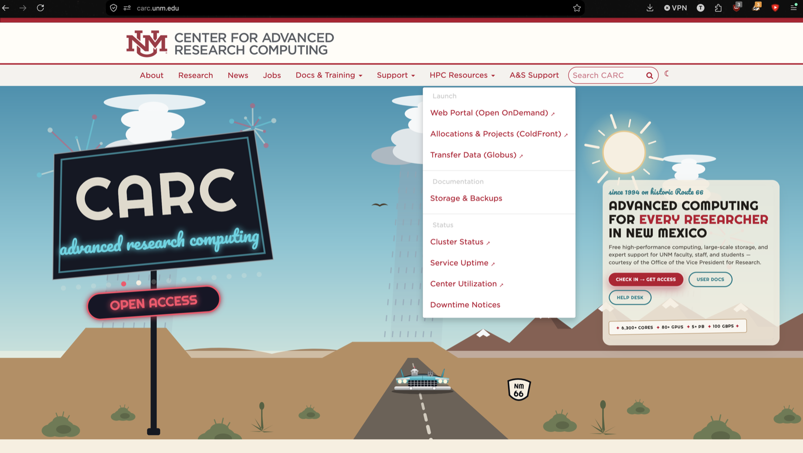

2. Under *Use your organizational login*, choose
   *University of New Mexico*, click **Continue**, and sign in with your
   NetID.

    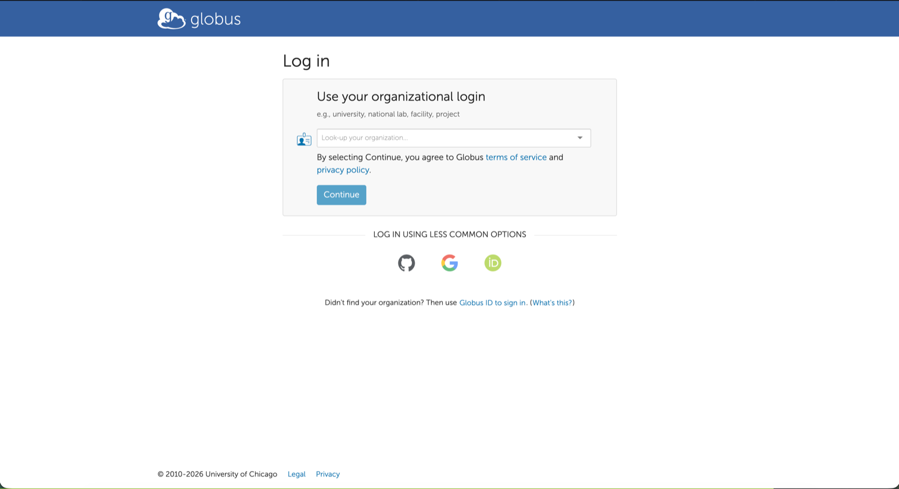

3. UNM asks to share your name and email with CILogon, which Globus uses
   for university logins. Choose one of the consent options and click
   **Accept**.

    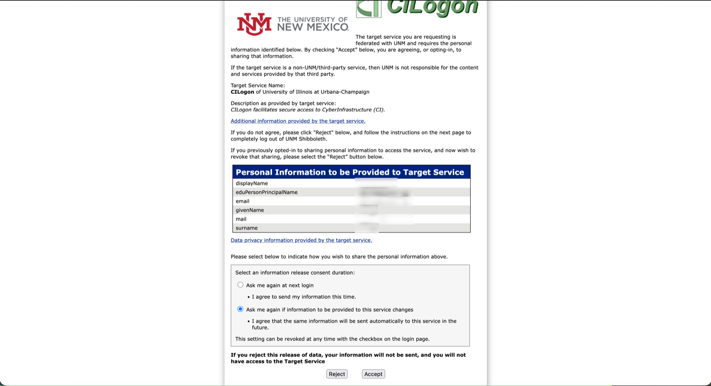

4. The first time you log in, Globus asks whether to link an existing Globus
   account. If you haven't used Globus before, click **Continue**.

    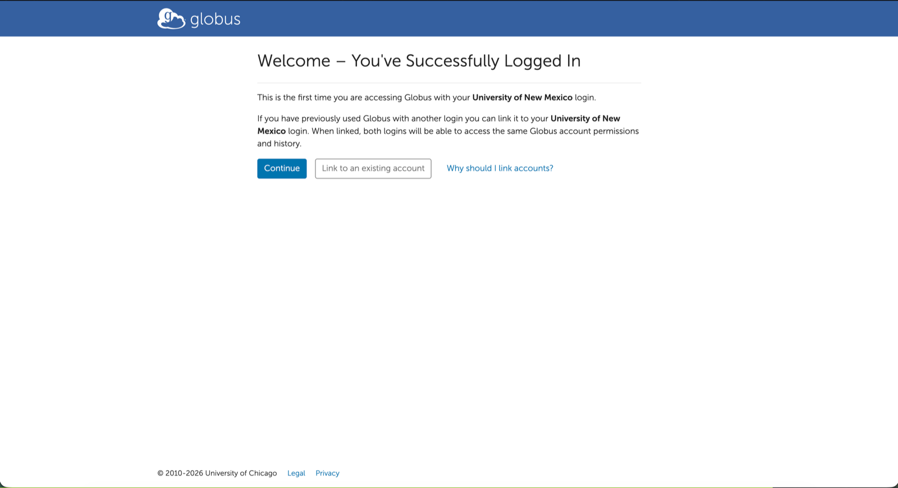

    Agree to the Terms of Service and Privacy Policy, click **Continue**, and
    click **Allow** when prompted.

    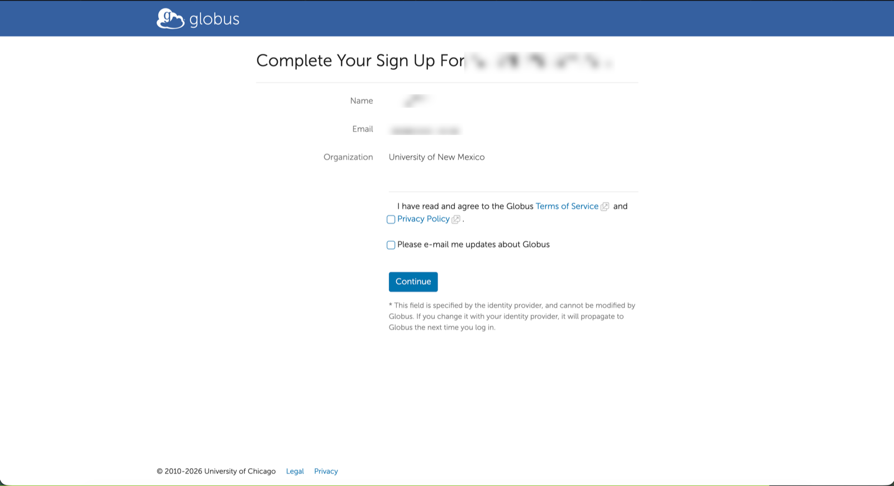

5. You're now on the Globus Dashboard. The menu on the left switches between
   pages; this guide uses **File Manager** and **Activity**.

    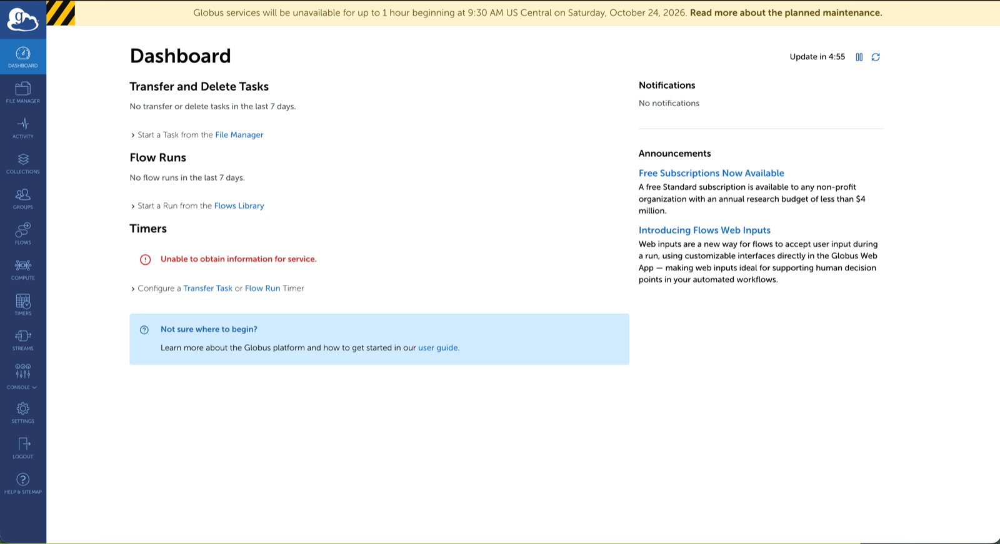

6. Open one of the CARC collections, for example
   [UNM CARC home](https://app.globus.org/file-manager?origin_id=858a3d27-0cbf-4de1-8dc8-89d14a3f1714){ target=_blank },
   or search for **UNM CARC** in the File Manager's *Collection* box. Globus
   says authentication/consent is required. Click **Continue**.

    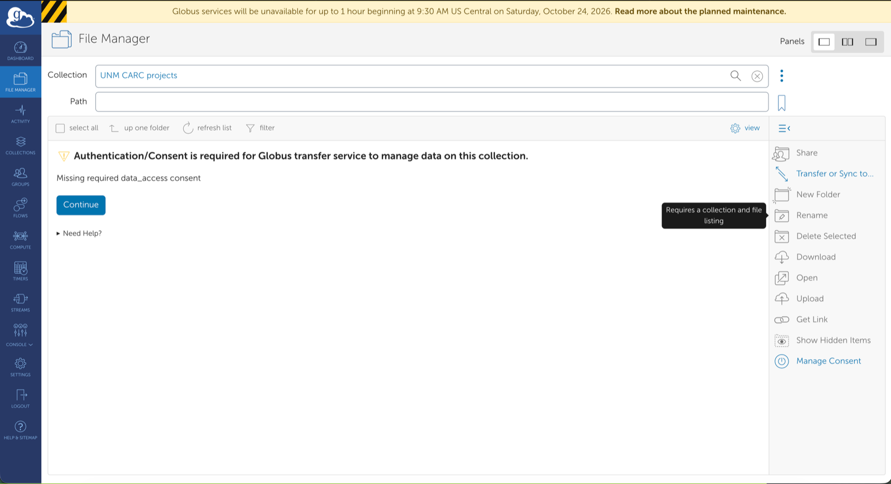

7. Click **Link a UNM CARC (carc.unm.edu) identity**. On the UNM CARC login
   page, enter your **CARC username and password**, and click **Allow** when
   prompted.

    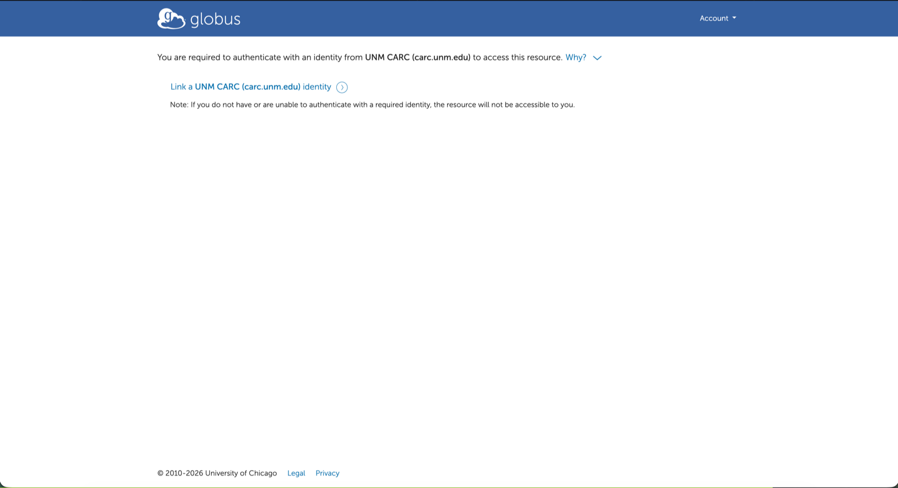

8. The File Manager now lists your files. To go to another directory, type
   its path in the *Path* box.

    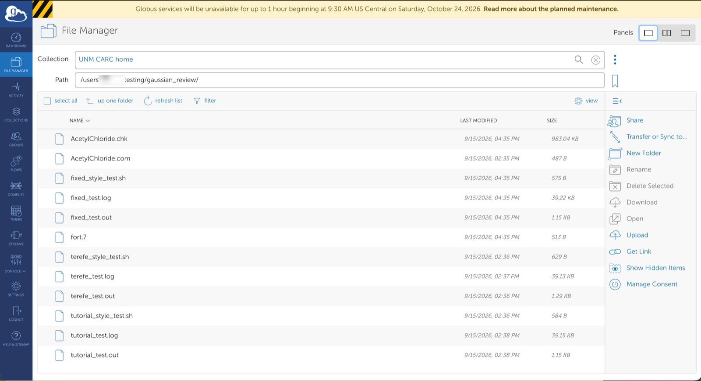

The first time you open each of the other CARC collections, Globus may ask
which identity to use. Click **Use my your-username@carc.unm.edu identity**.

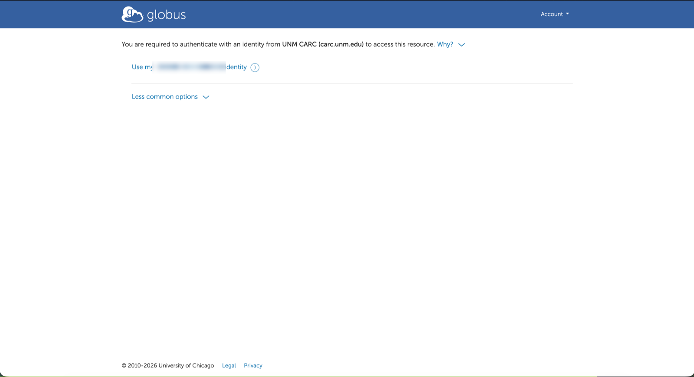

To check the link, open **Settings → Identities** in Globus. You'll see
`your-username@carc.unm.edu` listed under your Globus account.

!!! warning "Administrative accounts"

    Accounts with administrative privileges can't use the CARC collections.
    Use your ordinary CARC account.

## Transferring files

A transfer always runs between two collections. In the File Manager, open a
CARC collection in one panel and the other end in the second panel, select
files, then click the **Start** button above the panel you're copying from.
You can close the browser; Globus emails you when the transfer finishes.

* **Your laptop or desktop:** install
  [Globus Connect Personal](https://www.globus.org/globus-connect-personal){ target=_blank }.
  It turns your computer into a collection you can transfer to and from.
* **Another institution or a lab server:** search for its collection by name.
  You need an account there too.
* **Between CARC areas** (home, projects, scratch): open two CARC collections
  side by side.

Transfers to and from CARC are always encrypted. Sharing data with people
outside CARC through Globus isn't enabled yet.

### Example: home to scratch

This example copies a directory from UNM CARC home to UNM CARC scratch. The
same steps work between any two collections.

1. In the File Manager, click the middle **Panels** button in the top right
   to show two collections side by side. The left panel keeps the collection
   you already had open.

    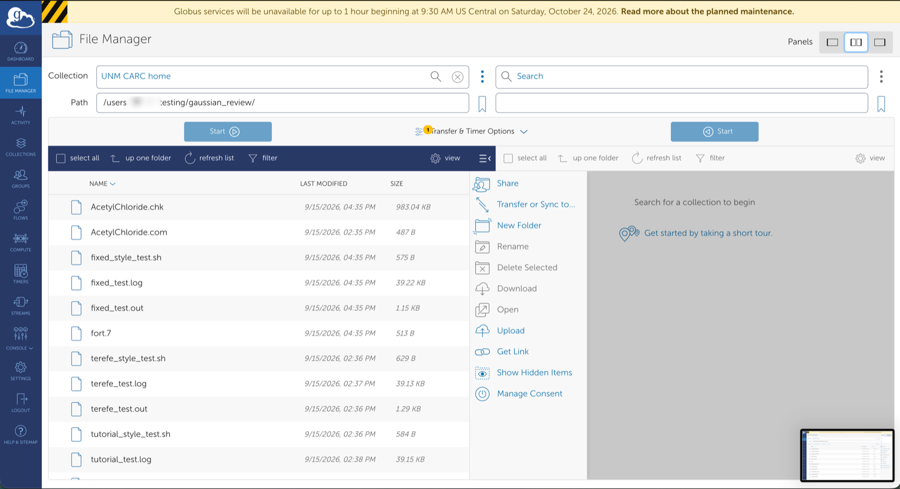

2. In the left panel, choose the source collection and path. In the right
   panel, search for the destination collection and enter its path.

    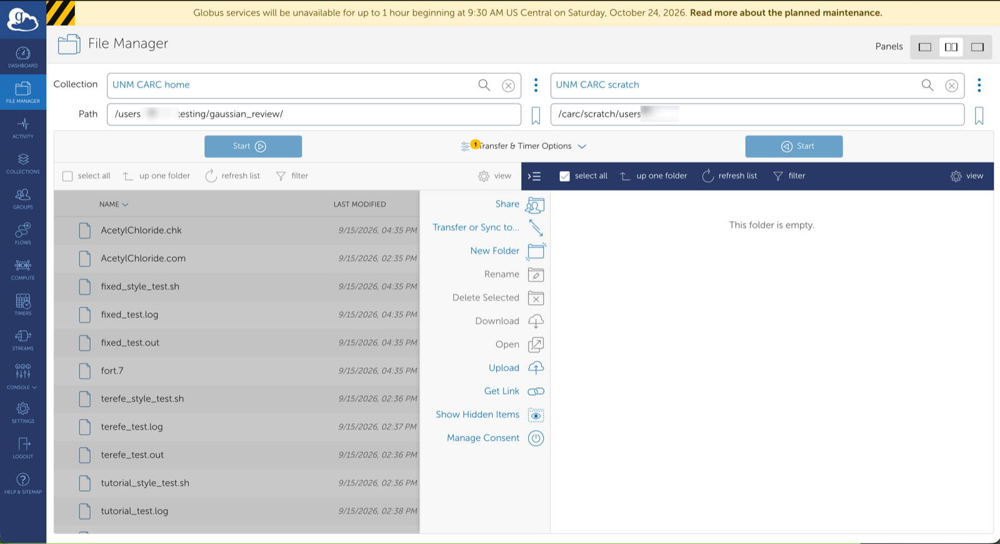

3. Optionally, open **Transfer & Timer Options**. The defaults suit most
   transfers. Useful settings:

    * **apply sync level:** copy only files that are new or changed on the
      source, like `rsync`. Handy for rerunning the same transfer.
    * **preserve source file modification times:** otherwise copied files
      get the transfer time as their modification time.
    * **Schedule Start / Repeat:** start later, or repeat on a schedule.

    File integrity checking and encryption are on by default, and the CARC
    collections require encryption.

    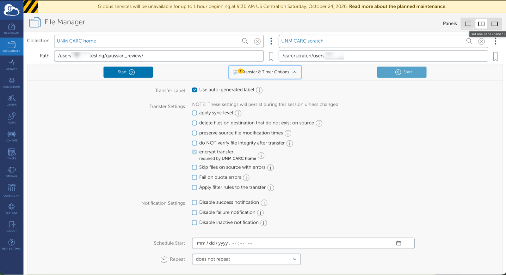

4. Select the files or folders to copy, or click **select all**. Then click
   the **Start** button on the source side, above the panel you're copying
   from. Each **Start** button sends files from its own panel to the other
   one; the one above the destination panel won't transfer your selection.
   A green *Transfer request submitted successfully* message appears.

    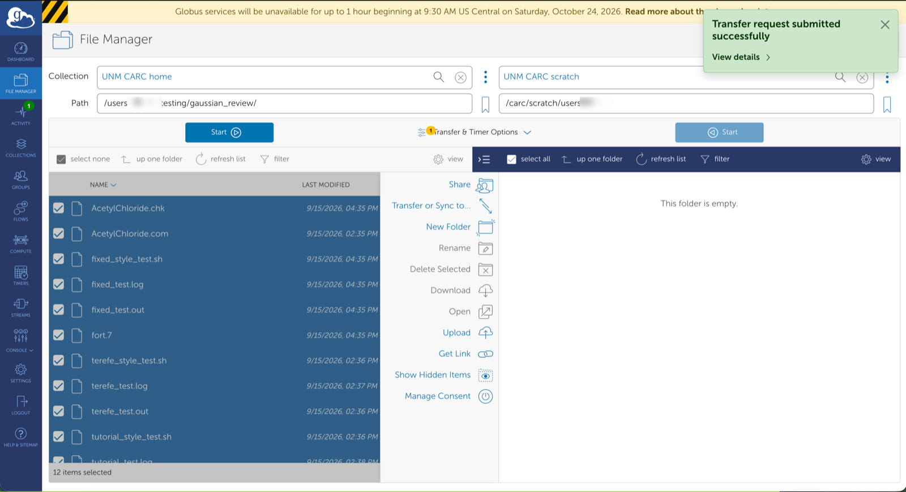

5. Click **View details** on the message, or **Activity** in the left menu,
   to follow the transfer. You don't need to keep the page open.

    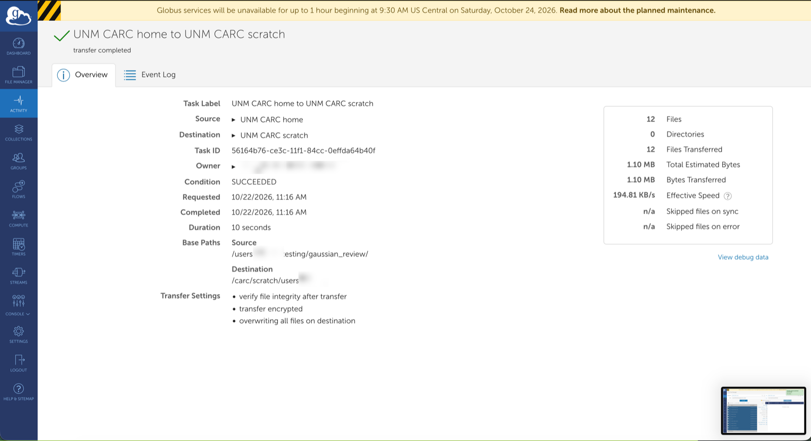

    Globus also emails you a summary when the transfer finishes.

    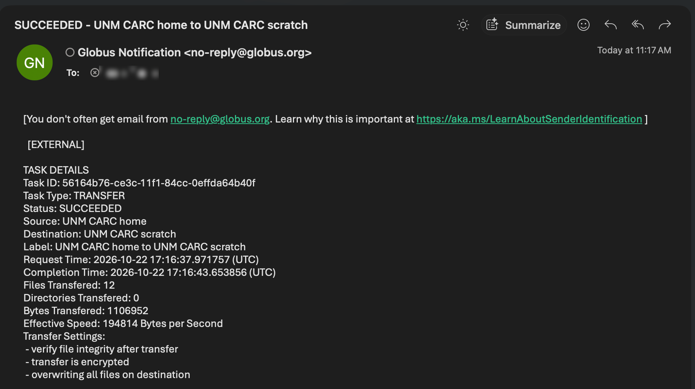

6. The destination panel doesn't update on its own. Click **refresh list**
   above the destination panel to see the copied files.

    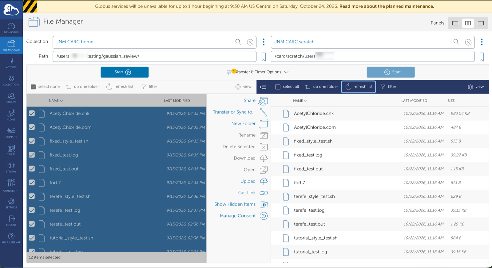

## Logging in again

Every 24 hours, Globus asks for your CARC password again. When you open a CARC
collection after that, you'll see the UNM CARC login page; sign in as in step
7. You don't need to link anything again, and transfers that are already
running keep going.

!!! tip "Locked out after wrong passwords?"

    Five wrong passwords in a row lock the UNM CARC login for a few minutes,
    and the login page says your account is temporarily disabled. Wait two
    minutes and try again; repeated lockouts last longer, up to 15 minutes.
    The lockout also applies to Open OnDemand logins, but not to SSH or your
    running jobs. If your password has expired, see
    [Password reset and one-time passwords](../../getting-started/password-reset.md).

## Troubleshooting

??? question "\"Identity set contains an identity from an allowed domain, but it does not map to a valid username\""

    Your CARC account isn't allowed to use Globus: it's an administrative
    account, or it isn't an active HPC account. Use your ordinary CARC
    account, or [open a ticket](../../support/help.md).

??? question "The UNM CARC login rejects a password that works for SSH"

    Check that you typed your CARC username, not your NetID. After five
    tries, wait for the lockout to clear.

??? question "I linked the wrong CARC account"

    Log out of the UNM CARC login at
    [auth.alliance.unm.edu](https://auth.alliance.unm.edu/realms/carc/protocol/openid-connect/logout){ target=_blank },
    remove the wrong identity under **Settings → Identities** in Globus, then
    open the collection again.

??? question "A transfer is slow or stuck"

    Check its status under **Activity** in Globus. Globus retries on its own.
    If it stays stuck, [open a ticket](../../support/help.md) with the transfer's
    task ID, which you'll find on its Activity page.

## Related pages

* [Transferring data](../../getting-started/transferring-data.md) - scp and rsync for smaller transfers.
* [Storage and backups](../../systems/storage.md) - paths, quotas, and what is backed up.
* [Getting help](../../support/help.md) - open a ticket if Globus misbehaves.
